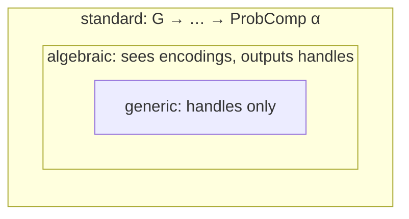
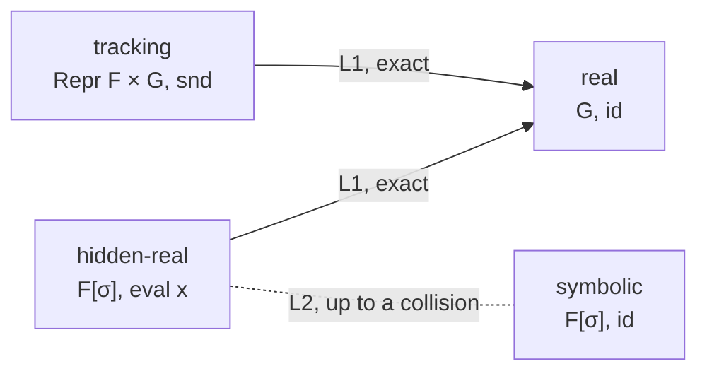
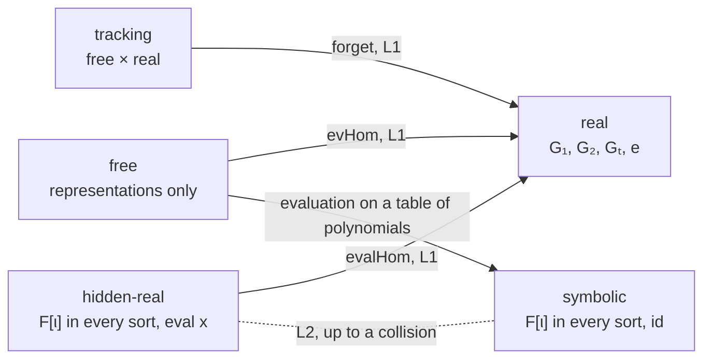
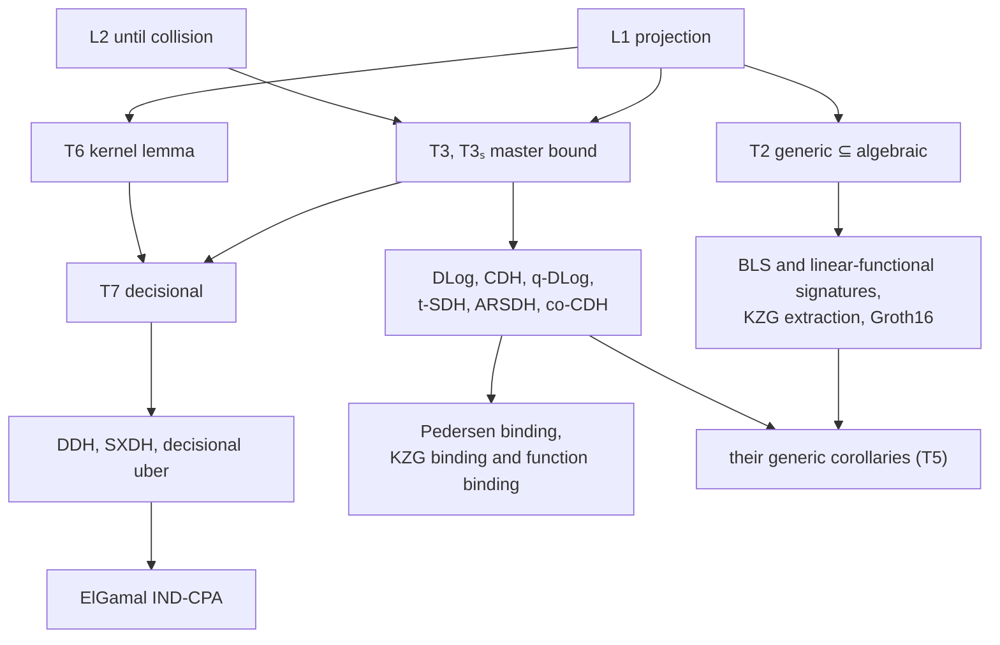

# Generic and algebraic group models for VCVio

Status: design note against VCVio `main` at `e3d105040`. D1–D15 are settled. The group-model
library is planned; Sections 4–6 describe its definitions and theorem targets. Section 12
separates those targets from paper arguments.

Sources used for the design:

| Repository | Commit | Lean | Licence |
|---|---|---|---|
| `Verified-zkEVM/VCVio` | `e3d105040` | v4.35.0 | Apache-2.0 |
| `Verified-zkEVM/ArkLib` | `4b6d206` | — | Apache-2.0 |
| `zksecurity/agm-lean` | `c207f29` | v4.34.0 | Apache-2.0 |
| `zksecurity/signature-security-lean` | `5541a23` | v4.34.0 | Apache-2.0 |
| `zcash/ironwood` | `def2cade` | v4.30.0 | MIT or Apache-2.0 |

VCVio uses Lean and Mathlib v4.35.0, with PolyFun and QuantumFoundations as dependencies.
ArkLib pins VCVio `6214f9077`. The signature repository pins VCVio `f5119c64e`, agm-lean `c207f29`
and ArkLib `7653a90`.

## 1. The problem

VCVio states the discrete-logarithm family against arbitrary adversaries:
`DiffieHellman.DLogAdversary F G` is `G → G → ProbComp F`, a type that contains exhaustive
search. That is the right type for a reduction inequality, and it is all VCVio has. There is no
class of adversaries restricted in how they touch the group, so three kinds of result cannot be
stated:

1. extraction from an adversary's group outputs (KZG knowledge soundness, BLS and other
   hash-and-sign schemes, Bulletproofs-style arguments);
2. unconditional lower bounds (generic hardness of DLog, CDH, the `q`-type assumptions);
3. cost statements about group work.

Four Lean developments supply the interfaces and proof ideas:

| Development | An algebraic adversary is | Basis | Cost |
|---|---|---|---|
| ArkLib | `GroupRepresentation`, mapped to typed points through `Additive G` over `ZMod p` | fixed finite basis | none |
| agm-lean `Interaction.lean` | an interactive program with `Explained` messages and an `IsAlgebraic` certificate | every received group element, per sort | none |
| signature-security-lean `Signatures/`, `Proofs/` | agm-lean's `Interaction.Adversary` directly, in `Signatures/Model/DirectAGM.lean` | token-indexed `Representation F Token := Token → F` over `Transcript Token G`; grouped `(β, γ, ξ)` coefficients are an internal view | separate `Signatures/Runtime/` and `Proofs/Runtime/` layers; weighted-solver bounds stay outside this library under D7 |
| ironwood `Zcash/Common/DiscreteLogRelation.lean` and AGM soundness tree | a computation returning typed `AlgebraicPoint` outputs | fixed enumerated basis | shallow group-work count relying on the opaque premise `StagedGroupWorkFaithful` |

The signature repository includes Schnorr in the AGM and ROM, Pointcheval–Sanders and
synchronized PS, a shared `EufCma` experiment, and `QueryAllowance`.

The goal is one model in VCVio into which each of these embeds, with the translations proved,
and with theorems that correspond to named results in the literature.

## 2. Three classes of adversary



*Figure 1. The three classes. Each inclusion is a semantics-preserving map of programs. Section 7
says in what sense each is proper.*

- A **standard** adversary receives group elements and returns anything. This is every existing
  VCVio adversary type.
- An **algebraic** adversary is a handle computation with an encoding oracle. Its group
  outputs acquire representations from the tracking run. Certified coefficient outputs give
  the presentation of Fuchsbauer, Kiltz and Loss (Section 4.4).
- A **generic** adversary (Shoup; Maurer) never sees a group element. It holds opaque handles and
  reaches the group through an oracle.

The inclusions are why the classes matter in different ways. A reduction inequality proved for
standard adversaries says the most and needs a hardness assumption. A statement about algebraic
adversaries is a weaker statement that makes extraction possible. A statement about generic
adversaries can be unconditional, and says nothing about an adversary that exploits the encoding
of a particular group.

## 3. What cannot be had together

Consider three properties of a model.

- **(A) Open language.** The adversary is an arbitrary Lean term of an `OracleComp` type.
- **(E) Real encodings.** The adversary sees the group elements themselves.
- **(W) Checked work.** A bound on the adversary's group work is a theorem checked by the kernel.

**Claim.** Any two can be had; all three cannot.

*Reason.* A Lean function has no intrinsic cost. With (A) and (E) the adversary is a term that
holds values of type `G`, and nothing stops it from using the ambient `AddCommGroup G` instance,
or bit-level arithmetic on an encoding, outside any counted interface. A bound on its group work
is then a promise about the term, not a theorem. This is a design argument, not a formal
statement.

| Corner | Keeps | Gives up | Who is there |
|---|---|---|---|
| algebraic, no cost | A, E | W | `signature-security-lean` inner theorems; ironwood, where the promise is the `opaque` predicate `StagedGroupWorkFaithful` |
| generic | A, W | E | this note: opaque handles, work is the number of oracle queries |
| machine model | E, W | A | `signature-security-lean` `Signatures/Runtime/` and `Proofs/Runtime/`: a closed language with a step semantics |

This note builds the first two corners in one model and proves how they relate. The third corner
is a question about machine models and belongs to
[`computational-complexity.md`](computational-complexity.md), tracked in
[VCVio#906](https://github.com/Verified-zkEVM/VCVio/issues/906); nothing here depends on it.

## 4. The model

Notation follows `DiffieHellman.lean`: `F` is the scalar field, `G` an `F`-module written
additively, `a • g` is the textbook `g^a`.

### 4.1 The group oracle

```lean
abbrev Handle := ℕ

inductive Query (F : Type) : Type
  | add (a b : Handle)
  | smul (c : F) (a : Handle)
  | eq (a b : Handle)

def spec (F : Type) : OracleSpec (Query F)
  | .add _ _ => Handle
  | .smul _ _ => Handle
  | .eq _ _ => Bool

abbrev genSpec (F : Type) := spec F + unifSpec
```

A handle is a position in a table of group elements. `add` and `smul` append an entry and return
its handle. The table only grows, so it is at once the adversary's state and the list of
elements it could ever output. A generic computation is an `OracleComp (genSpec F) α`: private
coins and the group oracle.

The adversary is not given the table. It receives handles and can request real encodings
through an oracle (Section 4.5). The oracle chooses where results go, so the table is an
append-only record. Out-of-range handles denote `0`: the handler is total and needs no failure
monad. Zero is always within the adversary's reach at no cost, so every count of values an
equality query can compare includes the table entries plus one.

### 4.2 One handler

```lean
def lookup [Zero V] (tbl : List V) (h : Handle) : V := tbl.getD h 0

def impl [Zero V] [Add V] [SMul F V] [DecidableEq W] (obs : V → W)
    (m : Type → Type) [Monad m] : QueryImpl (spec F) (StateT (List V) m)
  | .add a b => modifyGet fun tbl => (tbl.length, tbl ++ [lookup tbl a + lookup tbl b])
  | .smul c a => modifyGet fun tbl => (tbl.length, tbl ++ [c • lookup tbl a])
  | .eq a b => do
      let tbl ← get
      pure (decide (obs (lookup tbl a) = obs (lookup tbl b)))
```

Table entries live in an arbitrary `F`-module `V`. Equality is decided on the image of the
entries under an observation map `obs : V → W`. `run obs oa tbl` runs a generic computation on
an initial table. All the models in this note are instances.

| Instance | `V` | `obs` | Meaning |
|---|---|---|---|
| real | `G` | `id` | the group |
| tracking | `Repr F × G`, with `Repr F := Handle → F` | `Prod.snd` | each element stored with its coefficients over the elements that were given, not computed |
| symbolic | `MvPolynomial σ F` | `id` | each element is a polynomial in the unknown logarithms; equality is formal |
| hidden-real | `MvPolynomial σ F` | `MvPolynomial.eval x` | polynomials, compared by their value at the secret point `x` |

### 4.3 Two lemmas



*Figure 2. The instances and the two lemmas that connect them. L1 is an equality of
computations. L2 is a distance bound.*

**L1 (projection).** For a linear map `φ : V →ₗ[F] W` and any `obs : W → U`,

```lean
theorem run_map (φ : V →ₗ[F] W) (obs : W → U) (oa : OracleComp (genSpec F) α) (tbl : List V) :
    Prod.map id (List.map φ) <$> run (obs ∘ φ) oa tbl = run obs oa (tbl.map φ)
```

Running in `V` and observing through `φ` is the same computation as running in `W` on the image
table. The proof target in `Projection.lean` uses `OracleComp.map_run_simulateQ_eq_of_query_map_eq`
(`VCVio/OracleComp/SimSemantics/StateT/StateProjection.lean`) and a case split on the query. Two
instances:

- `φ := LinearMap.snd`: the tracking run and the real run have the same output distribution
  (`runTracking_map_snd`).
- `φ := MvPolynomial.aeval x`: the hidden-real run on polynomials `P` is the real run on their
  values `P.map (eval x)` (`runEval_map_eval`).

A companion fact, `impl_congr`: the handler depends on `obs` only through the equalities it
induces. In particular, composing `obs` with an injective map does not change the handler. It is
a target in `Projection.lean` (Section 6.2).

**L2 (identical until a collision).** Call an `eq a b` query a *collision* when the two values it
looks up differ and their observations agree. A looked-up value is a table entry, or zero for an
out-of-range handle. `run obs` and `run id` on the same table are the same
computation up to the first collision. Hence for every event `E` on the output,

`| Pr[run obs ∈ E] − Pr[run id ∈ E] | ≤ Pr[a collision occurs in run id]`.

The intended proof instruments `impl obs` with a flag set at the first collision and applies
`measureETVDist_simulateQ_run_le_prEvent_bad`
(`VCVio/ProgramLogic/Relational/SimulateQ/UntilBad.lean`). It is not proved yet.

L1 gives every exact statement in this note and L2 every bound. A generic lower bound is L2 at
`obs := eval x` with Schwartz–Zippel bounding the collision probability. An extraction argument
is L1 at `φ := snd`, after which the reduction reads coefficients off the table.

### 4.4 Tracking and the invariant

```lean
abbrev Repr (F : Type) := Handle → F

def trackInputs (xs : List G) : List (Repr F × G) :=
  xs.mapIdx fun i x => (Pi.single i 1, x)

def Repr.eval (r : Repr F) (tbl : List (Repr F × G)) : G :=
  ((List.range tbl.length).map fun h => r h • (lookup tbl h).2).sum

structure Explains (given : List Handle) (tbl : List (Repr F × G)) : Prop where
  given_nodup : given.Nodup
  given_lt : ∀ h ∈ given, h < tbl.length
  repr_given : ∀ h ∈ given, (lookup tbl h).1 = Pi.single h 1
  support_subset : ∀ e ∈ tbl, ∀ h, e.1 h ≠ 0 → h ∈ given
  eq_eval : ∀ e ∈ tbl, e.2 = e.1.eval tbl
```

An entry that was *given* (an input, an oracle reply) has representation `Pi.single h 1` at its
own handle `h`. An entry that was *computed* has the corresponding combination. The basis is
therefore the list `given` of handles of given entries, and it grows whenever the game hands out
another element. The invariant has five fields. The equation `eq_eval` alone holds of a table
in which every entry is declared its own basis element, whatever was given. `support_subset`
says that a computed entry is a combination of given ones. `given_lt` says that every given
handle is in the table, so `given` is finite. It follows from `repr_given`, because a handle
outside the table looks up the zero representation, and it is a field so that the adapters can
use it directly. For a run that starts from `trackInputs xs` and is handed nothing more, `given`
is `List.range xs.length`. The field `given_nodup` rules out repeated handles in this list;
in the sorted model it holds separately at every sort.

`Explains given` connects the tracked table to agm-lean's `Explained.Valid` and the proof
field of a typed `AlgebraicPoint`. The tracking state keeps a list of given handles per sort,
in arrival order, with one entry per receipt. Each receipt calls `pushGiven`, even if its value
has appeared before. The coefficient list is directly `given.map repr`; no reindexing lemma is
needed. T1a uses `given_nodup` to show that this conversion counts each basis handle exactly
once. Repeated group values still have distinct handles and distinct basis positions. Fresh
allocation by `pushGiven` preserves `given_nodup` while extending the table and the list; group
operations append only to the table.

`Repr F` is a function type so that it is a computable module (`Pi`). `Handle →₀ F` gives
finite support for free and makes every operation noncomputable. This is decision D4.

**Four presentations.**

Common setting: sorts `S` with `[DecidableEq S]`, a signature `σ : Sig S`, a field `F`, carriers
`G : S → Type` with `Module F (G s)`, and a real model `M : Model F σ G`. The core, T1a
and the certified interaction interface do not require finitely many sorts. T1b and its round
trip additionally require `[Fintype S]`.

**(H) Handle adversaries.** This is the definition, per D11.

```lean
abbrev genSpec F σ := spec F σ + unifSpec                    -- generic: the group oracle and coins
def encSpec (E : S → Type) : OracleSpec (S × Handle) := fun q => E q.1
-- algebraic adversary against a game Γ (handlers share the table):
--   OracleComp (spec F σ + encSpec E + unifSpec + Γ) α
```

The semantics is `run M obs random (gameImpl) A tbl`, with the shared sampling handler of
Section 5. For a game given on values,
`gameImpl := liftGame impl`, where

```lean
def handleSpec (Query) (Reply : Query → Type) : OracleSpec (Message Query (fun _ : S => Handle)) :=
  fun q => Message (Reply q.data) (fun _ => Handle)
def liftGame (impl : QueryImpl (plainSpec G Query Reply) m) :
    QueryImpl (handleSpec Query Reply) (StateT (Tbl G) m)
  -- look up every handle, call impl, push each element of the reply, return the new handles
```

**(G) Generic adversaries, as the projection of the tracking model.** The tracking model is
`(free σ).prod M`, a generic product of models. Its forgetful morphism is `Model.Hom.snd`. L1 for
`snd` says that the real run of a generic computation is the projection of its tracking run.
`Explains` on the tracked table says that every handle it holds has a representation over what it
was given (T2).

**(E) Certified explained adversaries.** agm-lean's `Interaction.Adversary F G Input Query Reply
Result`, under `GroupModel.Interaction`, with the module system and preserved definitions: `main` on
`Message Input G` and
`algebraic : ∀ input, IsAlgebraic input.groups (main input)`. The signature repository's adversary
is this same type. It receives randomness through a coin-bearing game-query wrapper, defined
in Section 5, rather than through a separate oracle in `Adversary.main`.

**(T) Typed points over a fixed basis.** These follow ironwood and ArkLib, additively:

```lean
structure AlgebraicPoint {ι : Type} [Fintype ι] (basis : ι → G) where
  point : G
  coeffs : ι → F
  eval_eq : ∑ i, coeffs i • basis i = point
```

A typed point is valid by construction. It is the presentation for games whose basis is fixed
before the adversary runs.

**Derived normal forms, not presentations.** Fixed-slot coefficient outputs, such as the signature
repository's `(β, γ, ξ)` over (generator, hash replies, signing replies), are a regrouping of (E)'s
basis list. They arrive with the BLS port.

### 4.5 Knobs

Everything else is an extra oracle beside `spec F`, with a handler that shares the table.

- **Encoding oracle** `encSpec E`, where `E : S → Type`: query `(s, h)` returns `E s`.
  Its handlers are absent (Maurer's model), real `enc s : G s → E s` applied to the entry,
  and lazy random labels. Real encodings give the algebraic class; random labels give Shoup's model.
- **Given elements.** `push v` appends an entry and returns its handle. Game oracles that hand
  out group elements (a signing oracle) call it. In the tracking instance a pushed entry is a new
  basis element.
- **Hash to group** `D →ₒ Handle`. A lazy random oracle whose cache is state of the game, holds
  elements and not handles, and is not addressed by the adversary. A fresh input samples `$ᵗ G`
  and stores the element. Every reply to the adversary, fresh or cached, pushes the element as a
  new given entry and returns the new handle. So a repeated query returns a second handle to the
  same element, and a lookup the game makes for itself, in signing or in verification, fills the
  cache and pushes nothing. This is the signature repository's `lazyImpl` together with its basis
  of received points, which that repository keeps apart in the same way, and it is what
  [ironwood issue 188](https://github.com/zcash/ironwood/issues/188) asks for. A cache of handles
  would give a repeated query one basis position where agm-lean and the signature repository
  have two. In the symbolic instance a fresh input is a fresh variable and a repeated one pushes
  the same variable again. Two handles to one variable are equal in the symbolic run and in the
  real run, so they are not a collision.
- **Decoding oracle** `E →ₒ Handle`, with `dec : E → Option G`. The adversary turns a bit string
  into a table entry whose logarithm nobody tracks. This is oblivious sampling (Lipmaa, Parisella
  and Siim).

### 4.6 Sorts

Several groups at once are handled by giving every query a sort `s : S` and keeping one table
per sort. A pairing is then one more kind of query, from two tables to a third. Section 6 does
this in general: the model takes a signature of structure maps, and the model of this section is
the signature with one sort and no maps. agm-lean is already indexed by sort
(`Groups G := (s : Tag) → List (G s)`).

### 4.7 Cost

`CostModel (spec F) ω` prices each query. The default is one unit per `add` and `smul` and
nothing for `eq`:

```lean
def unitCost : CostModel (spec F) ℕ where
  queryCost t := if t.isOp then 1 else 0
```

Two points are deliberate.

**Equality is free, and bounds are stated in the table size.** A real attacker who holds `m`
encodings finds a collision among them in about `m` steps by hashing. An adversary restricted to
an equality oracle needs up to `m(m−1)/2` queries for the same information. If equality queries
are priced, a budget of `B` queries buys only `√B` elements' worth of collisions and the
resulting bound, `(B + 1)/|F|` for DLog, overstates security quadratically when it is read as a
time bound. If instead the comparisons are charged to a simulator, a quadratic term `N²` enters
the budget, and once `N² ≥ |F|` a hardness premise over that budget holds only with `ε ≥ 1`. Both
errors disappear
when the bound is a function of the number `m` of table entries: `((m + 1) choose 2)` counts
every comparison the adversary could make among the entries and zero, whether or not it asks.

**`smul` is one query.** Allowing scalar multiplication at unit price only strengthens a lower
bound. For the overhead of a reduction, where the distinction matters, take `ω := ℕ × ℕ` and
count the two separately; `ResourceProfile` already carries a usage vector.

## 5. Theorems

`m₀` is the length of the initial table, `q` a bound on the number of `add` and `smul` queries
(an `IsQueryBoundP` hypothesis), `m := m₀ + q`.

The following translation theorems are targets. T1a and T1b are polymorphic in `N` with
`[Monad N] [LawfulMonad N]`, a game handler `impl : QueryImpl (plainSpec G Query Reply) N`,
and an explicit shared `random : QueryImpl unifSpec N`. Their run equations are exact
equalities of computations in `N`, including all effects of the game and sampling handlers.
`lookupMessage tbl : Message R (fun _ => Handle) → Message R G` reads the output handles.

```lean
abbrev HandleAdversary F σ E Input Query Reply Result :=
  Message Input (fun _ => Handle) →
    OracleComp (spec F σ + encSpec E + unifSpec + handleSpec Query Reply)
      (Message Result (fun _ => Handle))
```

Its `run M enc random impl input` starts from `input.groups` and answers the four components with
the real handler, `enc`, private coins, and `liftGame impl`. The runner uses
`StateT (Tbl G) N`, with private-coin handler `fun n => liftM (random n)`. This leaves the
handle table unchanged and preserves any effects of `random` in the ambient monad `N`.
After running the table state, the result is `N (Message Result (fun _ => Handle) × Tbl G)`;
the runner does not discard or reset state carried by `N`.

The certified presentation obtains the same coins through the game. Use a natural-number
query and `Fin (n + 1)` reply, matching `unifSpec` exactly:

```lean
abbrev CoinQuery (Query : Type) := Query ⊕ ℕ
def CoinReply (Reply : Query → Type) : CoinQuery Query → Type :=
  Sum.elim Reply (fun n => Fin (n + 1))

def withCoins {N : Type → Type} [Monad N] [LawfulMonad N]
    (random : QueryImpl unifSpec N) (impl : QueryImpl (plainSpec G Query Reply) N) :
    QueryImpl (plainSpec G (CoinQuery Query) (CoinReply Reply)) N
  | ⟨.inl q, groups⟩ => impl ⟨q, groups⟩
  | ⟨.inr n, _⟩ => do
      let x ← random n
      pure ⟨x, fun _ => []⟩
```

A coin request ignores group arguments and returns empty group lists at every sort, so it adds
no receipts to the basis. `toExplained` sends coin requests with empty group arguments and
empty explanations, forwards ordinary game requests through `Sum.inl`, and reads the sample
from the reply's data. `ofExplained` implements `Sum.inr n` by its private `unifSpec` oracle
and supplies the empty group reply to the certified continuation. The signature repository
uses the same coin-bearing game-query pattern in `Signatures/Model/SignatureInteraction.lean`
and `Signatures/Model/DirectAGM.lean`.

- **T2 (generic ⊆ algebraic, with representations).** For a computation `A` at any signature,
  and a tracking table with `Explains given tbl`:

  - `Prod.map id (mapTbl snd) <$> runTracking A tbl = runReal A (mapTbl snd tbl)`;
  - every `(x, tbl') ∈ support (runTracking A tbl)` satisfies `Explains given' tbl'`, where
    `given'` is `given` extended by the receipts of the run.

  The proof uses `QueryImpl.PreservesInv`. Milestone 1 covers source sorts, meaning sorts that are
  not the target of a structure map; that is every sort of `discreteSig`. The target sort of a
  pairing waits for `ReprT` (D10).
- **T1a (handles → explanations).** For any `enc`:

  ```lean
  def toExplained (A : HandleAdversary F (discreteSig S) E Input Query Reply Result) (enc) :
      Interaction.Adversary F G Input (CoinQuery Query) (CoinReply Reply) Result
  theorem toExplained_run {N : Type → Type} [Monad N] [LawfulMonad N]
      (random : QueryImpl unifSpec N) (impl : QueryImpl (plainSpec G Query Reply) N) :
      (fun z => z.1.value) <$> (toExplained A enc).run (withCoins random impl) input =
        (fun z => lookupMessage z.2 z.1) <$> A.run M enc random impl input
  ```

  `toExplained` simulates the group oracle in the tracking model on the received values. Each
  outgoing handle becomes the tracked value together with the coefficients `given.map repr`.
  `algebraic` is proved from `Explains`, including `given_nodup` for the coefficient conversion,
  and `_run` from L1 for `snd` and the matching private-coin handlers.
- **T1b (explanations → handles).** Under `[Fintype S]` and `[DecidableEq S]`, given a decoder
  `dec` with `∀ s g, dec s (enc s g) = g` (the real-value setting is `E := G`, `enc := id`,
  `dec := id`):

  ```lean
  def ofExplained [Fintype S] [DecidableEq S]
      (B : Interaction.Adversary F G Input (CoinQuery Query) (CoinReply Reply) Result) (dec) :
      HandleAdversary F (discreteSig S) E Input Query Reply Result
  theorem ofExplained_run [Fintype S] [DecidableEq S]
      {N : Type → Type} [Monad N] [LawfulMonad N]
      (random : QueryImpl unifSpec N) (impl : QueryImpl (plainSpec G Query Reply) N)
      (hdec : ∀ s g, dec s (enc s g) = g) :
      (fun z => lookupMessage z.2 z.1) <$> (ofExplained B dec).run M enc random impl input =
        (fun z => z.1.value) <$> B.run (withCoins random impl) input
  ```

  `ofExplained` enumerates the sorts and decodes the received handles. It builds each outgoing
  element from its coefficients with at most one `smul` and one `add` per nonzero coefficient,
  which is where `B.algebraic` is used. A certified adversary may output elements at every
  sort, while a handle run touches only finitely many sorts. Enumerability is therefore needed
  for this direction. The core model, T1a and agm-lean's interface remain general in `S`.
  Composing T1a with T1b gives the round trip for (E) under the same `[Fintype S]`,
  `[DecidableEq S]` and decoder assumptions, with certified runs using `withCoins random impl`.
  For a stateful game, take `N := StateT GameState ProbComp` and
  `random n := liftM (unifSpec.query n : ProbComp (Fin (n + 1)))`. This sampling handler
  preserves `GameState`; `impl` may read and update it, including a persistent hash cache.
  The handle runner then uses `StateT (Tbl G) (StateT GameState ProbComp)`. For every initial
  game state `st`, the equations retain the final game state as well as the output message:

  ```lean
  ((fun z => z.1.value) <$>
      (toExplained A enc).run (withCoins random impl) input).run st =
    ((fun z => lookupMessage z.2 z.1) <$> A.run M enc random impl input).run st

  ((fun z => lookupMessage z.2 z.1) <$>
      (ofExplained B dec).run M enc random impl input).run st =
    ((fun z => z.1.value) <$> B.run (withCoins random impl) input).run st
  ```

  Both sides have type `ProbComp (Message Result G × GameState)`. Only the auxiliary receipt
  list or handle table is forgotten. The second equation and the round trip retain T1b's
  finite-sort and decoder assumptions.
- **T1c (typed points ↔ valid explanations, fixed basis).**

  - `{out : Explained F R G // out.Valid inputs} ≃ R × ((s : S) → List (AlgebraicPoint (inputs s
    ·)))`,
    with basis `fun i : Fin (inputs s).length => (inputs s)[i]`.
  - At the level of programs, for games whose replies carry no group elements:
    `toTyped B := MonadAttach.attach`, using `CanReturn ↔ support` (`OracleComp/CanReturn.lean`)
    and `Adversary.run_valid`; and `ofTyped` forgets the proofs. Both preserve `run` after
    forgetting.
- **Generic → algebraic.** `toAlgebraic := liftComp` targets
  `spec F σ + encSpec E + unifSpec + Γ`, with
  `run_toAlgebraic : run (toAlgebraic A) = run A`. Then `toExplained ∘ toAlgebraic` gives every
  generic adversary a certified agm-lean presentation over `CoinQuery Query` and `CoinReply Reply`.
  The source is `spec F σ + unifSpec + Γ`; `liftComp` preserves both group queries and coins,
  and the two runners use the same `random : QueryImpl unifSpec N`. For message games, `Γ` is
  `handleSpec Query Reply`, and the certified run uses `withCoins random impl`.
- **ArkLib** (in ArkLib): `GroupRepresentation basis target ≃ {P : AlgebraicPoint (Additive.ofMul
  ∘ basis) // P.point = Additive.ofMul target}` over `ZMod p`.

T1a and T1b are stated at `discreteSig S`, which has sorts but no structure maps. That matches
agm-lean, which offers no pairing query and has no target-group representations. A version at
`pairingSig` for source-sort outputs follows from the same proofs once the game reads only
source-sort handles. Target outputs need `ReprT` (milestone 6).

**T3 (master bound).** Let the initial table be polynomials `P : List (MvPolynomial σ F)` of
total degree at most `d`, with `σ` finite and `x` uniform in `σ → F`. For every generic
computation and every event `E` on the pair of `x` and the output,

`| Pr[(x, hidden-real run at x) ∈ E] − Pr[(x, symbolic run) ∈ E] | ≤ ((m + 1) choose 2) · d / |F|`.

In the second probability the run does not depend on `x`.

*Argument.* By L2 the difference is at most the probability of a collision in the symbolic run.
The symbolic run does not depend on `x`. Its final table has at most `m` entries of degree at
most `d`. An equality query compares two values among these entries and zero, so there are at
most `((m + 1) choose 2)` nonzero differences, and `x` is a root of each with probability at
most `d/|F|`. The zero has to be counted: on the table `[X]` the query `eq 0 1` compares `X`
with zero, and it is a collision with probability `1/|F|`.

The probability form of Schwartz–Zippel exists in ArkLib as `prob_eval_zero_univ_le_div`
(`ArkLib/Data/MvPolynomial/SchwartzZippelCounting.lean`), stated in VCVio's `Pr{…}` notation
over `$ᵗ (Fin s → F)`. It imports one ArkLib file, `ArkLib.Data.Probability.Uniform`, so it has
to be moved down before VCVio can use it.

The argument uses one property of the distribution of `x`: a nonzero polynomial of total degree
at most `k` vanishes at `x` with probability at most `ε k`. T3 is stated with `ε` as a
hypothesis. For uniform `x` it is `k/|F|`. ArkLib's `t`-SDH and ARSDH games sample one trapdoor
uniformly among the nonzero scalars, where it is `k/(|F| − 1)`. Section 6.4 gives the form with
several sorts.

**T4 (generic hardness).** Corollaries of T3 and L1, each stated about the standard-model
adversary that a generic one induces:

```lean
def DLogAdversary.ofGeneric (A : OracleComp (genSpec F) F) : DiffieHellman.DLogAdversary F G :=
  fun g X => Prod.fst <$> runReal A [g, X]

theorem dlogExperiment_ofGeneric_le (g : G) (hg : g ≠ 0) (A : OracleComp (genSpec F) F) (q : ℕ)
    (hq : IsQueryBoundP A (fun i => isGroupOp i = true) q) :
    𝒟[DiffieHellman.dlogExperiment g (DLogAdversary.ofGeneric (G := G) A)] {true} ≤
      (((q + 3).choose 2 + 1 : ℕ) : ℝ≥0∞) / Fintype.card F
```

*Argument.* The table `[g, x • g]` is the image of `[1, X]` under `P ↦ (eval x P) • g`, which is
linear, and `c ↦ c • g` is injective because `g ≠ 0` and `F` is a field. So the real run is the
hidden-real run with `d = 1`: L1 for that map, and `impl_congr` to replace the observation
`P ↦ (eval x P) • g` by `eval x`. By T3 with `m = q + 2` it is within
`((q + 3) choose 2)/|F|` of the symbolic run, whose output is independent of `x` and so equals
`x` with probability `1/|F|`. With no group operation at all an adversary succeeds with
probability `min(3, |F|)/|F|`: it tests `x • g` against `g` and against zero, and otherwise
guesses a third value when there is one. The bound at `q = 0` is `4/|F|`.

The same template gives CDH and the discrete-log relation problem, and with a pairing the
`(q₁, q₂)`-DLog family of Bauer, Fuchsbauer and Loss, co-CDH, `t`-SDH and ARSDH (T8 in
Section 6.5), with the constants fixed by the proofs. For the relation problem on `n` random
elements the table starts with `n` entries, so the bound has `n` in it:
`((q + n + 1).choose 2 + 1)/|F|`. DDH needs one more lemma (T6). Note the
form: the statement is about `ofGeneric A`, a `DLogAdversary`, so it composes with every
existing reduction in VCVio. No hypothesis quantifies over solvers.

**T5 (transfer).** Write a reduction once, as a handler that implements the scheme's oracles on
top of the group oracle. Then:

- for an algebraic adversary `A` it gives the usual inequality
  `adv(A) ≤ adv_P(reduction A) + ε` against the standard-model problem `P`;
- for a generic `A` the reduction is itself generic, so T4 applies to it once its group work is
  counted. The count is a hypothesis about the handler and does not follow from its being one. A
  *cost certificate* bounds the handler's group operations by `c_t` for each of `A`'s queries of
  kind `t` (group operations, equality tests, and each scheme oracle, separately) and by `c₀`
  for setup and the final step. Then `reduction A` makes at most `c₀ + Σ_t c_t · q_t` group
  operations, where `q_t` bounds `A`'s queries of kind `t`. This is a weighted form of
  `IsQueryBoundP.simulateQ_run_of_step`
  (`VCVio/OracleComp/QueryTracking/QueryBound/Simulation.lean`), which has per-step bounds as
  hypotheses in the same way. T4 then gives the unconditional bound
  `adv(A) ≤ bound_P(c₀ + Σ_t c_t · q_t) + ε`. A bound in `A`'s group operations alone needs
  `c_t = 0` for every other kind. Equality tests are free for `A`, so a handler that spends a
  group operation on each of them has no bound of that form.

The second item is the transfer studied by Jaeger and Mohan. Its formal content here is *handle
virtualization*: handles are predictable, so a reduction that shares its table with the
adversary would let the adversary address the reduction's intermediate values. The reduction
keeps a translation table from the adversary's handles to its own. This is a named construction,
`GroupModel.virtualize`, to be built once.

A scheme that hashes group elements (Schnorr) cannot be written against `genSpec F` alone,
because a handle is not data that identifies an element. It needs the encoding oracle: with
real encodings the result is an algebraic-model theorem, with random labels a Shoup-model one.
This is the gap that "Hashing in generic groups" (ePrint 2026/466) addresses.

## 6. Pairings and other structure maps

### 6.1 A signature of structure maps

A pairing group is three `F`-modules and a bilinear map `e : G₁ →ₗ[F] G₂ →ₗ[F] Gₜ`. To the
adversary it is one more way to make a table entry: from an entry of `G₁` and an entry of `G₂`,
an entry of `Gₜ`. Within each of the three groups nothing changes. The isomorphism
`ψ : G₂ → G₁` of a Type 2 group is the same kind of thing with one argument. So the model takes a
*signature*: the sorts, and the names and sorts of the linear and bilinear maps on offer.

```lean
structure Sig (S : Type) where
  Lin : Type
  lsrc : Lin → S
  ltgt : Lin → S
  Bil : Type
  src₁ : Bil → S
  src₂ : Bil → S
  tgt : Bil → S

inductive Query (F : Type) {S : Type} (σ : Sig S) : Type
  | add (s : S) (a b : Handle)
  | smul (s : S) (c : F) (a : Handle)
  | eq (s : S) (a b : Handle)
  | lin (o : σ.Lin) (a : Handle)
  | bil (o : σ.Bil) (a b : Handle)

structure Model (F : Type) [CommSemiring F] {S : Type} (σ : Sig S) (V : S → Type)
    [∀ s, AddCommMonoid (V s)] [∀ s, Module F (V s)] where
  lin : (o : σ.Lin) → V (σ.lsrc o) →ₗ[F] V (σ.ltgt o)
  bil : (o : σ.Bil) → V (σ.src₁ o) →ₗ[F] V (σ.src₂ o) →ₗ[F] V (σ.tgt o)

structure Model.Hom (M : Model F σ V) (N : Model F σ W) where
  toFun : (s : S) → V s →ₗ[F] W s
  map_lin : ∀ o x, toFun (σ.ltgt o) (M.lin o x) = N.lin o (toFun _ x)
  map_bil : ∀ o x y, toFun (σ.tgt o) (M.bil o x y) = N.bil o (toFun _ x) (toFun _ y)
```

There is one table per sort, `Tbl V := (s : S) → List (V s)`, and a handle is a position in the
table of its sort. The handler `impl M obs` is the handler of Section 4.2 in each sort, plus one
case per structure map that appends `M.lin o _` or `M.bil o _ _` to the table of the map's target
sort. Equality at sort `s` is decided on the image under `obs s : V s → U s`.

| Signature | Sorts | Linear maps | Bilinear maps | Setting |
|---|---|---|---|---|
| `groupSig` | one | none | none | Sections 4 and 5 |
| `discreteSig S` | `S` | none | none | T1a and T1b |
| `pairingSig` | `g₁`, `g₂`, `gₜ` | none | `e : g₁ × g₂ → gₜ` | Type 3 |
| `pairingIsoSig` | `g₁`, `g₂`, `gₜ` | `ψ : g₂ → g₁` | `e : g₁ × g₂ → gₜ` | Type 2 |
| `symmPairingSig` | source, target | none | `e : source × source → target` | Type 1 |

The three types are those of Galbraith, Paterson and Smart. Boneh, Gentry, Lynn and Shacham
state co-CDH and aggregate signatures for a pair of groups with a computable isomorphism
`ψ : G₂ → G₁`, which is `pairingIsoSig`. The planned library modules are:

- Planned `VCVio/CryptoFoundations/GroupModel/Signature.lean`: signatures and models.
- Planned `VCVio/CryptoFoundations/GroupModel/Oracle.lean`: tables, handler and runner.
- Planned `VCVio/CryptoFoundations/GroupModel/Projection.lean`: L1, `impl_congr` and T6.
- Planned `VCVio/CryptoFoundations/GroupModel/Instances.lean`: real, symbolic and free instances.
- Planned `VCVio/CryptoFoundations/GroupModel/Tracking.lean`: tracking and its invariant.

These are slices 1–2 of milestone 1; target-sort representations wait for milestone 6.

### 6.2 How this relates to the one-group model

The pairing model does not restrict the group model. It has more queries, so it has more
adversaries. The relation has three parts.

**The group model is the signature with no maps.** At `groupSig` a model is a module, a morphism
is a linear map, and the sorted handler is the handler of Section 4.2. The library defines the
one-group names as abbreviations at `groupSig`.

**L1 holds for every signature.** For a morphism of models `φ : M.Hom N` and any observation
`obs` on `N`,

```lean
theorem run_map (φ : M.Hom N) (obs : (s : S) → W s → U s) (oa : OracleComp (genSpec F σ) α)
    (tbl : Tbl V) :
    Prod.map id (mapTbl fun s => φ.toFun s) <$> run M (fun s => obs s ∘ φ.toFun s) oa tbl =
      run N obs oa (mapTbl (fun s => φ.toFun s) tbl)
```

The proof in slice 1 is uniform in the signature, by the argument of Section 4.3 with two more
cases.
A second lemma, `impl_congr`, says that the handler depends on `obs` only through the equalities
it induces (`impl_congr`): if `obs s x = obs s y ↔ obs' s x = obs' s y` for all `s`, `x`, `y`,
then `impl M obs = impl M obs'`.

**Attacks go up, lower bounds go down.** A map of signatures `σ → τ` (sorts to sorts, map names
to map names, compatibly) turns a `τ`-model into a `σ`-model by forgetting, and a
`σ`-computation into a `τ`-computation by renaming its queries. When the map is injective on
sorts, running the translated computation in a `τ`-model is running the original in the forgotten
model, on the tables of the sorts in the image. Injectivity is needed because a handle is a
position in the table of its sort. A map that sends two sorts to one interleaves their entries
and shifts their handles, so the translated computation is a different computation: with two sorts
and empty tables, `add` at the first sort and then `add` at the second return handles `0` and
`0`, and after merging the sorts they return `0` and `1`. Such a map (a Type 3 computation run
in a Type 1 group, both source sorts sent to the one source sort) needs the handle translation
of T5. The injective case is a target. Two consequences follow.

- Every one-group adversary is a pairing-group adversary that happens not to pair. So a lower
  bound proved in the pairing model implies the same bound in the group model.
- A lower bound proved in the group model says nothing once a pairing is available. DDH is the
  example (P1 in Section 7): hard for every generic one-group adversary, solved by two pairing
  queries and one equality test in a Type 1 group.

Most bounds survive the pairing with the degree at the target sort raised (Section 6.4). The
ones that do not are exactly those where the new map creates a new relation among the given
elements (Section 6.5).

### 6.3 The instances



*Figure 3. The instances of the sorted model. Solid arrows are morphisms of models, so each is
an exact statement by L1. The kernel lemma (Section 6.5) compares the symbolic runs on two
tables through the two evaluation maps out of the free model.*

**Real.** `real e` has carriers `G₁`, `G₂`, `Gₜ` and the Mathlib bilinear map `e` as its one
bilinear map. This is how ArkLib's KZG takes its pairing
(`Additive G₁ →ₗ[ZMod p] Additive G₂ →ₗ[ZMod p] Additive Gₜ`); the signature repository's
`BilinearPairing` class has the same content.

**Symbolic.** `symbolic F σ ι` is one definition for every signature: the carrier is
`MvPolynomial ι F` at every sort, every linear map is the identity, every bilinear map is
multiplication. An entry of the target sort is therefore a polynomial of degree up to the sum of
the degrees of the two source sorts.

**Hidden-real.** The symbolic model observed through `MvPolynomial.eval x`. For a pairing group
with generators `g₁`, `g₂`, the maps `P ↦ P(x) • g₁`, `P ↦ P(x) • g₂`, `P ↦ P(x) • e g₁ g₂` form
a morphism `evalHom e g₁ g₂ x` from the symbolic model to `real e` (the pairing case is
`(P * Q)(x) • e g₁ g₂ = e (P(x) • g₁) (Q(x) • g₂)`). By L1 the symbolic model observed through
this morphism is the real run on the values. By `impl_congr` that is the hidden-real run, as
soon as `c ↦ c • g` is injective at each sort: `g₁ ≠ 0`, `g₂ ≠ 0` and `e g₁ g₂ ≠ 0`.
Non-degeneracy of the pairing enters the theory here and nowhere else. It is the hypothesis
`pairing g₁ g₂ ≠ 0` that ArkLib's KZG theorems already carry. For `pairingIsoSig` the
generators must satisfy `ψ g₂ = g₁`.

**Free.** Representations without the elements they represent. For a pairing group:

```lean
abbrev Repr (F : Type) := Handle → F
abbrev ReprT (F : Type) := (Handle → F) × (Handle → Handle → F)

-- (0, fun i j => r₁ i * r₂ j)
def outer (F : Type) [CommSemiring F] : Repr F →ₗ[F] Repr F →ₗ[F] ReprT F
def free (F : Type) [CommSemiring F] : Model F pairingSig (PFam (Repr F) (Repr F) (ReprT F))
def evHom (e : G₁ →ₗ[F] G₂ →ₗ[F] Gₜ) (xs : List G₁) (ys : List G₂) (zs : List Gₜ) :
    (free F).Hom (real e)
```

A source entry has a coefficient for each given element of its sort. A target entry has a
coefficient for each given target element and a coefficient for each pair of a given `G₁`
element and a given `G₂` element. The pairing of two representations is their outer product.
`evHom` evaluates a representation on the given elements, using `e` for the pairs; that it is a
morphism is the identity `Σᵢⱼ (r₁ i * r₂ j) • e xᵢ yⱼ = e (Σᵢ r₁ i • xᵢ) (Σⱼ r₂ j • yⱼ)`
(`evReprT_outer`, a milestone-6 target). This is the representation the literature asks of an
algebraic algorithm in a
bilinear group: Rotem's statement of the model of Bauer, Fuchsbauer and Loss explains a target
output by coefficients over the pairings of pairs of inputs.

**Tracking.** The product of the free and real models, with `tracking.forget` the second
projection `Model.Hom.snd`. L1 gives equality of the tracking and real outputs. T2 also needs
the `Explains` invariant; milestone 1 proves it for source sorts, and milestone 6 covers target
sorts with `ReprT`.

Two remarks on representations.

*When every element is given before the adversary runs, L1 does the work of the invariant.* Run
in the free model, observed through `evHom`, on the table of basis representations. L1 for
`evHom` says that this run, with its table mapped through `evHom`, is the real run on the given
elements. So every entry of the real table is the value of the corresponding representation on
the given elements alone, since `evHom` reads only the coordinates of the given handles. No
separate induction is needed. Every problem of the uber family has this shape. The product form
and the invariant `Explains given` of Section 4.4 are needed when the game hands out elements
during the run.

*The free model is built per signature.* The group and pairing signatures have closed forms
like the one shown. For `pairingIsoSig` a `G₁` representation also has a coefficient for each
given `G₂` element, through `ψ`, and a target representation a coefficient for each pair of
given `G₂` elements. A general signature needs more. When the output of a bilinear map can be
the input of another map (multilinear maps), representations are polynomials of higher degree.
When linear maps compose or cycle (an endomorphism `L` of a sort), representations range over
words in the maps, because `v`, `L v`, `L (L v)`, … need not be combinations of `v`. Nothing
planned needs either case. This is decision D10.

### 6.4 The master bound with several sorts

Call `D : S → ℕ` a *degree bound* for an initial symbolic table if every initial entry of sort
`s` has total degree at most `D s`, and `D (lsrc o) ≤ D (ltgt o)` and
`D (src₁ o) + D (src₂ o) ≤ D (tgt o)` for every structure map. By induction on the run every
entry of sort `s` then has degree at most `D s`. With `d_s` the degree of the initial entries:

| Signature | Least degree bound |
|---|---|
| `groupSig` | `D = d` |
| `pairingSig` | `D₁ = d₁`, `D₂ = d₂`, `Dₜ = max dₜ (d₁ + d₂)` |
| `pairingIsoSig` | `D₁ = max d₁ d₂`, `D₂ = d₂`, `Dₜ = max dₜ (D₁ + d₂)` |
| `symmPairingSig` | `D = d`, `Dₜ = max dₜ (2d)` |

Let `m s` be the number of entries of sort `s` at the end of the run: the initial ones plus the
queries that append to sort `s`, bounded by an `IsQueryBoundP` hypothesis per sort. Let `ε k`
bound the probability that a nonzero polynomial of total degree at most `k` vanishes at `x`.

**T3ₛ (master bound, sorted).** For every generic computation and every event `E`,

`| Pr[hidden-real run at x ∈ E] − Pr[symbolic run ∈ E] | ≤ Σ_s ((m s + 1) choose 2) · ε (D s)`.

The proof is that of T3: L2 for the sorted handler, then a union bound over the pairs among the
entries of each sort and its zero. At `groupSig` with `x` uniform this is T3.

*Example: DLog in `G₁` of a Type 3 group.* The initial tables are `[1, X]`, `[1]` and `[]`, so
`D = (1, 0, 1)`. Values at `G₂` are constants, and two constants that differ never collide
(`ε 0 = 0`). The bound on the success probability is
`(((m₁ + 1) choose 2) + ((mₜ + 1) choose 2) + 1)/|F|`. The pairing adds a collision term for
the target group and does not raise the degree. If `x • g₂` is also given, as in a KZG reference
string, then `D = (1, 1, 2)`.

### 6.5 Decisional problems and the kernel lemma

T3ₛ compares a real game with its symbolic counterpart. A decisional problem compares two real
games. The missing step compares two symbolic runs.

**T6 (kernel lemma).** Let `φ : L.Hom M` and `ψ : L.Hom N` be morphisms out of one model that
identify the same pairs: `φ s x = φ s y ↔ ψ s x = ψ s y` for all `s`, `x`, `y`. Then for every
generic computation and every table `tbl` in `L`, the run in `M` on `φ tbl` and the run in `N` on
`ψ tbl` have the same output distribution.

```lean
theorem run_fst_eq_of_kernel_eq (φ : L.Hom M) (ψ : L.Hom N)
    (h : ∀ s x y, φ.toFun s x = φ.toFun s y ↔ ψ.toFun s x = ψ.toFun s y)
    (oa : OracleComp (genSpec F σ) α) (tbl : Tbl K) :
    Prod.fst <$> run M (fun _ => id) oa (mapTbl (fun s => φ.toFun s) tbl) =
      Prod.fst <$> run N (fun _ => id) oa (mapTbl (fun s => ψ.toFun s) tbl)
```

The slice-1 proof in `Projection.lean` uses L1 twice and `impl_congr`, for every signature.

*Use.* Take `L` to be the free model, `M` and `N` symbolic models, and `φ`, `ψ` evaluation on two
initial tables `T₀`, `T₁` of the same shape. The hypothesis says that `T₀` and `T₁` satisfy the
same linear relations among the entries the signature makes reachable at each sort. At
`pairingSig` the reachable entries of a source sort are its given entries, and those of the
target sort are the given target entries and the products of a given `G₁` entry with a given
`G₂` entry. At `pairingIsoSig` the given `G₂` entries are reachable in `G₁` as well, through
`ψ`, and so are their products with given `G₂` entries at the target sort. Call the span of the
reachable entries of a sort its *accessible span*: it is the image of the evaluation map out of
the free model of the signature. Call the condition on `T₀` and `T₁` *the same relation kernel*.
Then:

**T7 (decisional master theorem).** If `T₀` and `T₁` have the same relation kernel, with degree
bounds `D⁰` and `D¹`, then for every generic computation the hidden-real runs on `T₀` and on `T₁`
are within `Σ_s ((m s + 1) choose 2) · (ε (D⁰ s) + ε (D¹ s))`.

*Argument.* T3ₛ on each side and T6 in the middle.

Three instances show what the hypothesis means.

- *DDH, one group.* `T₀ = [1, A, B, A·B]` and `T₁ = [1, A, B, C]`. Each is linearly independent,
  so each evaluation map is injective on the representations supported on the four given
  handles. A representation is a function on all handles, and both maps ignore the handles
  beyond the fourth, so the two kernels are the same subspace. With `m = q + 4` the bound is
  `3 · ((m + 1) choose 2)/|F|`, stated as a bound on
  `ddhAdvantage g (DDHAdversary.ofGeneric A)`.
- *DDH with a symmetric pairing.* The same tables at `symmPairingSig`. At the target sort the
  products satisfy `A · B − 1 · (A·B) = 0` in `T₀` and `A · B − 1 · C ≠ 0` in `T₁`. The kernels
  differ, T7 does not apply, and the relation that differs is the attack.
- *The uber assumption.* `T₀` has source polynomials `P`, `R`, target polynomials `Q` and one
  more target entry `f`; `T₁` has a fresh variable `Y` in place of `f`. The kernels agree exactly
  when `f` is not in the accessible span of the target sort, and that span depends on the
  signature. At `pairingSig` it is spanned by `Q` and the products `Pᵢ · Rⱼ`. At `pairingIsoSig`
  it also contains the products `Rᵢ · Rⱼ`, because `ψ` carries `R` into `G₁`. At
  `symmPairingSig`, which has one source list `P`, it is spanned by `Q` and the products
  `Pᵢ · Pⱼ`. With `P = [1]`, `R = [1, X]`, `Q = []` and `f = X²` the condition holds at
  `pairingSig` and fails at `pairingIsoSig`. For a symmetric pairing it is the independence
  condition in the master theorem of Boneh, Boyen and Goh, and T7 has that theorem's content at
  each pairing signature, with the constant the proof gives.

T7 is a sufficient condition. A difference between the kernels is an attack under one more
hypothesis. Suppose a representation `r` evaluates to zero on `T₀` and to a polynomial `W ≠ 0`
on `T₁`. The computation that builds the entry `r` describes and tests it against zero answers
`true` with probability `1` on `T₀` and with probability at most `ε (deg W)` on `T₁`, so its
advantage is at least `1 − ε (deg W)`. For each nonzero coefficient of `r` it makes the
structure-map queries that reach the term (at most two, at the signatures above), one `smul`
and one `add`. This is the source of P1 and P3 in Section 7. A formal difference alone is not an
attack: over a field of `p` elements the tables `[0, X^p − X]` and `[0, 0]` have different
kernels and the same values at every point, and there `ε (deg W) = 1`.

**T8 (computational master theorem).** Suppose the adversary's output in the symbolic run
determines a polynomial `W` of total degree at most `k`, and that winning the game implies both
`W ≠ 0` and `W(x) = 0`. Then the success probability in the real game is at most the bound of
T3ₛ plus `ε k`.

*Argument.* By T3ₛ, applied to an event on the pair of `x` and the output, it is enough to bound
the event in the symbolic run. There the output, and so `W`, is independent of `x`.

| Problem | Initial tables | Output | `W` | Degree |
|---|---|---|---|---|
| `q`-DLog | `[1, X, …, X^q]` | a scalar `c` | `X − c` | `1` |
| `(q₁, q₂)`-DLog | `[1, …, X^q₁]`, `[1, …, X^q₂]` | a scalar `c` | `X − c` | `1` |
| CDH | `[1, A, B]` | a handle with entry `p` | `A · B − p` | `2` |
| co-CDH with `ψ` (Type 2) | `[H]`, `[1, A]` | a `G₁` handle with entry `p` | `A · H − p` | `2` |
| co-CDH with `x • g₁` given (Type 3) | `[1, A, H]`, `[1, A]` | a `G₁` handle with entry `p` | `A · H − p` | `2` |
| uber, computational, target `f` of sort `s` outside the accessible span of `s` | `P`, `R`, `Q` | a handle of sort `s` with entry `p` | `f − p` | `max (deg f) (D s)` |
| `t`-SDH | `[1, X, …, X^D]`, `[1, X]` | `c` and a `G₁` handle with entry `p` | `p · (X + c) − 1` | `D + 1` |
| ARSDH | `[1, X, …, X^D]`, `[1, X]` | a set `S` of `D + 1` scalars and `G₁` handles with entries `a`, `b` | `b · Z_S − a` | `2D + 1` |

In every row but the last, `W ≠ 0` holds for every output: by degree, and in the uber row by the
hypothesis on `f`. For ARSDH, `W = 0` would
force `a = b · Z_S` with `deg a ≤ D < deg Z_S`, hence `a = b = 0`, and the winning condition
`h₁ ≠ 1` excludes `a = 0`. The last two rows are the problems of ArkLib's
`KZG/HardnessAssumptions.lean`, whose games sample the trapdoor among nonzero scalars, so
`ε k = k/(|F| − 1)` there.

The two co-CDH rows are different problems. Boneh, Gentry, Lynn and Shacham give the adversary
`g₂`, `a • g₂` and `h`, in a group with `ψ`. The signature repository's `BLS.CoCDH.coCDHExp` is
stated for Type 3 and gives `x • g₁` as well, which no map there produces from `x • g₂`. In both
`p` has degree at most `1`, so `W ≠ 0`. `coCDHExp` samples `h` uniformly in `G₁`. Writing it as
`H • g₁` with `H` uniform needs `c ↦ c • g₁` to be a bijection, the hypothesis that
`pedersenCommit.binding_le_dlog` carries for its generator.

Bauer, Fuchsbauer and Loss prove more for the algebraic class: the uber family reduces to
`q`-DLog. In this note's terms that is a T5-style theorem, with a reduction that reads the
adversary's representation from the tracking run, forms `W`, and finds its roots. Rotem lowers
the `q` required from the maximum total degree to the maximum degree in one variable.

### 6.6 Knobs per sort

The knobs of Section 4.5 are per sort, and the models of the literature differ in which sort
gets which.

| Model | Source sorts | Target sort |
|---|---|---|
| generic bilinear group | handles | handles |
| semi-generic (Jager and Rupp) | handles | real encodings; target outputs are data |
| algebraic (Fuchsbauer, Kiltz and Loss; Bauer, Fuchsbauer and Loss) | real encodings, outputs are handles | real encodings, outputs are handles |
| algebraic in the source groups | real encodings, outputs are handles | real encodings, outputs are data |

In KZG, Groth16, PLONK and BLS the adversary outputs source-group elements only and the verifier
computes the pairings. Their proofs use representations at the source sorts and never a target
representation. So the fourth row is enough for them, and it is the first to build. `ReprT` is
needed when an adversary outputs target elements.

With real encodings an algebraic adversary can compute a pairing itself and hold the result as
data. To output a target element with an explanation it has to obtain it through the `bil`
query. This matches the remark in the Marlin paper that the generic model needs an explicit
pairing oracle and the algebraic model does not.

The hash-to-group oracle is per sort. Galbraith, Paterson and Smart note that a Type 2 group has
no efficient hash into `G₂`. A Type 2 instance in the library therefore offers `ψ` and hashing
into `G₁`, and a Type 3 instance offers hashing into both source groups and no `ψ`.

### 6.7 Cost with several sorts

`CostModel (spec F σ) ω` prices each kind of query separately: `add` and `smul` per sort, each
structure map by name. A pairing costs far more than a group operation in every deployed curve,
so a single count would be uninformative for a reduction's overhead. For lower bounds the
quantity that matters is again the table size per sort, `m s`. Equality stays free at every
sort.

## 7. Separation tests

Small theorems that keep the classes and the signatures honest. Each is a regression test, not a
research result.

S1 and S2 say in what sense the inclusions of Figure 1 are proper. Both are about a challenge
`x • g` with `x` uniform in `F` and `g ≠ 0`. The classes are sets of Lean terms with no bound on
computation, so for such a challenge neither inclusion is proper as a statement about what can
be computed at all. A generic computation with `|F|` operations finds `x` by search, and an
algebraic adversary that sees an injective encoding can run the same search away from the group.
What distinguishes the classes is the number of group operations (S1) and a reduction (S2). A
challenge outside the span of the given elements is another matter: no handle adversary reaches
it, whatever it computes.

- **S1, generic against algebraic at a bounded number of operations.** Take `G := F` as a module
  over itself, `g := 1`, `enc := id`. One encoding query solves DLog with probability `1` and no
  group operation, while T4 bounds every generic adversary with `q` operations on the same
  group. The bound of T4 says nothing about a concrete group.
- **S2, algebraic against standard without decoding: a reduction.** For a fixed `g ≠ 0` the game
  samples `x` uniformly from `F`, sets `Y := x • g`, gives the adversary a handle to `g` and
  `enc Y` as data, and asks for a handle to `Y`. A handle adversary that wins hands a DLog
  solver its answer: run it on the tracking table for `[g]` and read the coefficient `c` of the
  returned handle. The handle denotes `c • g`, and `c • g = x • g` exactly when `c = x`, because
  `g ≠ 0` and `F` is a field. So its success probability equals the DLog advantage of a named
  reduction. That is the whole statement, and it needs nothing of `enc`. The challenge
  distribution is part of it. Were `Y` uniform in a `G` larger than `F • g`, a handle adversary
  could not reach a `Y` outside `F • g`, and the equality would fail.

  The two trivial attacks need the encoding to carry the element. When `enc` is injective on
  `F • g`, `enc Y` determines `Y` and a standard adversary returns it. With a decoding oracle
  such that `dec (enc v) = some v` for `v` in `F • g`, one query wins. A constant `enc` gives
  neither. The statement is not an unconditional bound, and it does not separate the classes as
  defined: under the same injectivity an algebraic adversary can search for the logarithm of `Y`
  away from the group and build the handle with one `smul`. A separation needs a bound on that
  computation, which this model does not express (Section 3). This is the kind of example by
  which Katz, Zhang and Zhou, and Zhandry, compare the models: the encoding carries information.
- **S3, labels matter.** Recorded as documentation, with Zhandry's examples as the reference: the
  Fiat–Shamir transform over group elements is expressible against `genSpec F` plus a label
  oracle and not against `genSpec F`.
- **P1, a pairing breaks DDH.** At `symmPairingSig`, with `g`, `a • g`, `b • g`, `c • g` at
  handles `0` to `3`: pair handles `1` and `2`, pair handles `0` and `3`, test equality at the
  target sort. The answer is `true` on a Diffie–Hellman tuple and, when `e g g ≠ 0`, `true` with
  probability `1/|F|` on a random one. The same four elements at `groupSig` satisfy the generic
  DDH bound of Section 6.5. A lower bound is a statement about a signature.
- **P2, no cross-group map, no attack.** At `pairingSig`, DDH in `G₁` with `g₂` also given
  satisfies the bound of T7: the tables `[1, A, B, A·B]`, `[1]` and `[1, A, B, C]`, `[1]` have
  the same relation kernel.
- **P3, the isomorphism breaks DDH in `G₂`.** At `pairingIsoSig`, with `g₂`, `a • g₂`, `b • g₂`
  and `c • g₂` given in `G₂`: apply `ψ` to `a • g₂` and to `g₂`, pair the first with `b • g₂`
  and the second with `c • g₂`, and test equality at the target sort. That is two `ψ` queries
  (one if `ψ g₂` is also given), two pairings and one equality test. DDH in `G₁` still satisfies
  the bound of T7.

## 8. What the machinery proves

Three kinds of theorem become available. None of them can be stated in VCVio or ArkLib today.

1. **Unconditional bounds for problems**, about the standard-model adversary that a generic
   computation induces (`ofGeneric`).
2. **Unconditional bounds for schemes**, by composing a bound of the first kind with a reduction
   inequality that already exists. The existing inequality is used as it is. What is new is that
   the reduction of a generic adversary is generic, with a counted number of operations.
3. **Extraction against algebraic adversaries**, where the reduction or extractor reads
   representations from the tracking run.



*Figure 4. From the lemmas to results. Each arrow is "is used in the proof of".*

The tables give each result, what it needs, the existing declaration it composes with, and its
source. Constants are those of the paper argument and are fixed by the proofs. `m = m₀ + q`, and
each collision term counts the pairs among `m` entries and zero, `((m + 1) choose 2)`.

**Milestones and placement.** The model lives under `VCVio/CryptoFoundations/GroupModel/`;
problem statements belong under `VCVio/CryptoFoundations/HardnessAssumptions/`. Named schemes
belong under `VCVio/Schemes/BLS/` and `VCVio/Schemes/LinearFunctional/`, following
[the repository ownership map](repository-layout.md). `Examples/` is for instructional consumers.
Names follow [the cryptographic naming rules](../agents/crypto.md#naming): experiments are
programs, advantages evaluate them, and reduction inequalities name their reductions.

New library files use `module`, `public import` for public dependencies, and plain
`public section`. Use per-declaration `@[expose]` only where unfolding is part of the API,
such as `impl`, `run` and `lookup`. The expose-boundary ceiling excludes new file-wide exposure.

**Milestone 1: core and presentations.** Paths below are planned; `GroupModel/` abbreviates
`VCVio/CryptoFoundations/GroupModel/`.

1. **Sorted core and projection.** `Signature.lean`, `Oracle.lean`, `Projection.lean`, and
   planned `VCVioTest/GroupModel/Basic.lean`: `Sig`, `Query`, `spec`, `Model`, `Model.Hom`,
   `Model.prod`,
   `Hom.fst/snd`, `Tbl`, `lookup`, `append`, `push`, `mapTbl`, `impl`, and `run` with a game
   handler. Prove `run_map` for any pair of game handlers related by `φ`, `impl_congr`, and
   `run_fst_eq_of_kernel_eq`. Define `groupSig`, `discreteSig`, `pairingSig`, `pairingIsoSig`,
   and `symmPairingSig`; add executable runs over `ZMod 7`.
2. **Instances and tracking.** `Instances.lean`, `Tracking.lean`, and tests: `real`, `symbolic`,
   `free` for `groupSig`, `discreteSig`, and the source sorts of `pairingSig`; `evHom`,
   `evalHom`, `tracking := free.prod real`, `pushGiven`, `Explains`, and T2. Depends on slice 1.
3. **Certified interaction.** `Interaction.lean` and `VCVioTest/GroupModel/Interaction/`: move
   agm-lean's module and its three test files, preserving the zkSecurity / Kobi Gurkan header
   and adopting the module system and `GroupModel.Interaction` namespace. The authors have
   agreed to the move.
4. **Handles and explanations.** `Encoding.lean`, `Game.lean`, and `Algebraic.lean`: `encSpec`
   and its real handler, `handleSpec`, `liftGame`, `withCoins`, `HandleAdversary`, `toAlgebraic`,
   `toExplained`, `ofExplained`, T1a, T1b, and their round trip in a lawful monad `N` with a shared
   `random : QueryImpl unifSpec N`. T1b and its round trip require `[Fintype S]` and
   `[DecidableEq S]`; T1a remains general in `S`. Test a private-coin-only adversary and a
   repeated-query stateful game that answers identical empty-group requests with `false` then
   `true`. Use `StateT GameState ProbComp` with lifted uniform sampling, and compare both output
   and final game state across translations. Depends on slices 1–3.
5. **Typed points.** `Typed.lean`: `AlgebraicPoint`, the T1c equivalence, `toTyped`, and
   `ofTyped`. Depends on slice 3.
6. **ArkLib adapter.** In ArkLib's `ArkLib/AGM/Basic.lean`, delete `GroupValTable` and the oracle
   half that follows it, including the unfinished `Adversary.run`. Keep `GroupRepresentation`
   and add its adapter to `AlgebraicPoint`; update `ArkLib.lean`, the axiom baseline and the
   VCVio pin. `ArkLibTest/AGM/Basic.lean` is unchanged. Depends on slice 5 being merged.

Slice 1 comes first. Slices 2 and 3 can then proceed in parallel, followed by 4 and 5, then 6.
Each VCVio slice runs `./scripts/validate.sh` and `./scripts/update-lib.sh`, adds no `sorry`,
and leaves the axiom-sweep baseline untouched.

**Milestone 2: generic lower bounds.** `Collision.lean` supplies L2 and `Cost.lean` supplies
query accounting. This milestone includes the Schwartz–Zippel move and T3/T4, with T6/T7 for
DDH. A second route is [PolyFun#279](https://github.com/Verified-zkEVM/PolyFun/pull/279), whose
M5 counting kernel supplies generic-DLog and DDH witnesses. Either route must expose bounds
that compose with the named VCVio reductions.

**Later milestones.** Milestone 3 covers the discrete-log relation problem and its reduction;
milestone 4 ports linear-functional signatures and BLS; milestone 5 proves T5 with handle
virtualization and cost certificates. Milestone 6 covers pairing bounds, KZG, `ReprT`, and the
free models for Types 1 and 2. Milestone 7 adds random labels and decoding. The real encoding
handler needed by T1 belongs to milestone 1.

### 8.1 One group (milestone 2)

| Result | Statement | Composes with | Source |
|---|---|---|---|
| generic DLog | `dlogExperiment g (ofGeneric A) ≤ ((q + 3).choose 2 + 1)/\|F\|` |  | Shoup |
| generic CDH | `cdhExperiment g (ofGeneric A) ≤ ((q + 4).choose 2 + 2)/\|F\|` |  | Shoup |
| generic DDH | `ddhAdvantage g (ofGeneric A) ≤ 3 · (q + 5).choose 2/\|F\|` |  | Shoup; T7 |
| Pedersen binding, unconditional | for a generic binder with `q` operations, success at most `((q + 9).choose 2 + 1)/\|F\|` | `pedersenCommit.binding_le_dlog` and `pedersenCommit.dlogReduction` in `VCVio/Schemes/Pedersen.lean` |  |
| ElGamal one-time IND-CPA, unconditional | for a generic adversary, twice the generic DDH bound at a counted number of operations | `elGamalAsymmEnc.elGamal_oneTime_advantage_eq_two_mul_ddhAdvantage` in `Examples/ElGamal/Basic.lean` |  |
| ElGamal IND-CPA with `q` queries, unconditional | `2q` times the generic DDH bound | `elGamalAsymmEnc.elGamal_IND_CPA_le_q_mul_ddh`, after it is restated (below) |  |

The three constants come from T3, T7 and T8 as follows. DLog: `m = q + 2`, degree `1`, and
`1/|F|` for the final guess. CDH: `m = q + 3`, degree `1`, and `W = A · B − p` of degree `2`.
DDH: `m = q + 4`, with degree `2` on the real side and `1` on the random side.

The Pedersen entry is the smallest complete test of the design. `pedersenCommit.dlogReduction`
checks two openings with four `smul`, two `add` and two equality tests, so a generic binder with
`q` operations yields a generic DLog solver with `q + 6`, and the two existing lemmas compose
with T4 without change.

The multi-query ElGamal theorem does not compose as it stands. Its hypothesis `hddh` bounds
`ddhAdvantage gen (IND_CPA_OneTime_DDHReduction adv)` for every one-time adversary `adv`, of any
kind. A generic DDH bound covers generic adversaries only. The theorem has to be restated with
the hybrid adversaries named, as a sum of their DDH advantages, before a generic bound can be
substituted. The one-time theorem is an equation about one named reduction and composes now.

### 8.2 Algebraic adversaries and the transfer (milestones 1 and 3 to 5)

| Result | Statement | Composes with | Source |
|---|---|---|---|
| presentations agree (T1) | exact translations among the four presentations of Section 4.4 | agm-lean `Adversary.run_valid`; ArkLib `GroupRepresentation` | Fuchsbauer, Kiltz, Loss |
| discrete-log relation | finding a nontrivial relation among `n` random elements is at most DLog plus `1/\|F\|`; against a generic adversary, by T5, at most `((q + 3n + 3).choose 2 + 2)/\|F\|` | proved in ironwood on other foundations; T4 | Jaeger, Tessaro, Lemma 3 |
| linear-functional signatures, BLS | `advantage ≤ adv(goodReduction A) + adv(badReduction A) + 1/\|F\|` against `(1,1)`-DLog | proved in `signature-security-lean` at VCVio `f5119c64e` |  |
| BLS, unconditional | a bound in `q`, `q_H`, `q_S` and `\|F\|` only | the row above, T5, and generic `(1,1)`-DLog. The last is a bound at `pairingSig` (Section 8.3), so this row is reached in milestone 6 and not before | Jaeger, Mohan |
| inner-product and Bulletproofs-style arguments | binding of the vector commitment against an algebraic prover | the discrete-log relation row | Jaeger, Tessaro |

The generic bound for the relation problem has the number `n` of given elements in it. The
reduction programs slot `i` as `xᵢ • g + yᵢ • Z` from the DLog challenge `Z`, as ironwood's
`ProgrammedBasisEmbedding` does. That is two `smul` and one `add`, so its cost certificate has
`c₀ = 3n`, cost `1` for each group operation of `A` and `0` for each equality test. T4 at
`q + 3n` operations and the loss `1/|F|` give `((q + 3n + 3).choose 2 + 2)/|F|`. T3 on the table
of `n` variables gives the smaller `((q + n + 1).choose 2 + 1)/|F|` directly (Section 5). No
bound can omit `n`: among `|F| + 1` multiples of `g` two are equal, free equality tests find
them, and their difference is a relation.

### 8.3 Pairings (milestone 6)

| Result | Statement | Composes with | Source |
|---|---|---|---|
| generic `(q₁, q₂)`-DLog; co-CDH in both forms | T8 | the signature repository's `dlog11Exp` and `coCDHExp` (the Type 3 form) | Bauer, Fuchsbauer, Loss; Boneh, Gentry, Lynn, Shacham |
| generic `t`-SDH and ARSDH | T8, for ArkLib's experiments: `tSdhExperiment D (ofGeneric A)` and `arsdhExperiment D (ofGeneric A)` | ArkLib `KZG/HardnessAssumptions.lean` | Boneh, Boyen; Chiesa, Guan, Knabenhans, Yu, Definition 9.6 |
| SXDH; decisional uber | T7, with the accessible span of the signature at hand |  | Boneh, Boyen, Goh; Boyen |
| KZG evaluation binding and function binding, unconditional | for a generic adversary, at most the generic `t`-SDH and ARSDH bounds at a counted number of operations | ArkLib `KZG.CommitmentScheme.binding` with `bindingReduction`, `KZG.CommitmentScheme.function_binding` with `reduction` |  |
| KZG extraction | a named straight-line extractor; `Pr[accept ∧ p(z) ≠ v] ≤` the `t`-SDH advantage of a named reduction | ArkLib `Commitment.extractability`, today a placeholder, once its game says what the extractor receives (below) | Marlin, Theorem B.12 |
| uber family from `q`-DLog, algebraic adversaries | a reduction that factors `W` |  | Bauer, Fuchsbauer, Loss; Rotem |
| BLS and aggregate BLS under co-CDH | Type 3, and Type 2 with `ψ` | milestone 4 | Boneh, Gentry, Lynn, Shacham |
| Groth16 knowledge soundness | algebraic, from `q`-DLog; then generic by T5 | no Groth16 in ArkLib yet | Groth; Fuchsbauer, Kiltz, Loss |

Two results need a change in ArkLib first.

*The KZG binding theorems take a hypothesis that no bound in this note can discharge.*
`KZG.CommitmentScheme.binding` assumes `Groups.tSdhAssumption … tSdhError`, which is
`∀ adversary, tSdhExperiment … adversary ≤ tSdhError`, and
`KZG.CommitmentScheme.function_binding` assumes `Groups.arsdhAssumption` in the same form. The
adversary ranges over all Lean functions of its type, including one that recovers the trapdoor
from the reference string by a classical choice. On a group that satisfies the theorems' other
hypotheses that adversary wins with probability `1`, so the premise holds only with error at
least `1` and the conclusion says nothing. A generic bound is about `ofGeneric A` only and
cannot supply a premise about all adversaries. Both proofs already contain the fix: each ends
with a `calc` that reaches
`tSdhExperiment … (bindingReduction … adversary)` or `arsdhExperiment … (reduction … adversary)`
before applying the premise. Stating that inequality, with the reduction named, is the theorem
that composes. This is an argument from reading the statements; it has not been formalized.

*`Commitment.extractability` needs a game, and the game has to say what the extractor sees.*
ArkLib's definition quantifies over a
`StraightlineExtractor oSpec Data Commitment := Commitment → QueryLog oSpec → Data`, and its body
is currently `False` with the game commented out. With the group oracle in `oSpec`, replaying a
committer's query log in the free model, from the reference string as the initial table, gives
the representation of every handle the committer created. The extractor type above lacks two
things that this replay needs. The commitment key is the initial table and is not a query. The
handle the committer returns is not in the log, and the value of the commitment does not
identify it: with no query at all, returning the handle of `X` under one trapdoor and the handle
of `X²` under another can give the same group element and the same empty log. So the game must
fix an observation contract first. The extractor receives the commitment key, the log, and the
committer's output handle; in the coefficient presentation of T1 it receives the representation
that an algebraic committer outputs with its commitment, which is what the extractor in Marlin's
proof is given. The representation of that handle over the powers in the reference string is
the committed polynomial.

### 8.4 Encodings and decoding (milestone 7)

| Result | Why it waits | Composes with |
|---|---|---|
| Schnorr EUF-CMA, unconditional in the labelled model | the scheme hashes a group element, so both scheme and adversary need labels | `Schnorr.signature_euf_cma` in `VCVio/Schemes/Schnorr/Signature.lean`, a forking bound against `dlogExperiment g (dlogReduction …)`; the composed bound has the square-root loss of forking |
| Schnorr, tight, algebraic adversaries | a different proof, not a composition | Fuchsbauer, Plouviez, Seurin |
| hashed ElGamal, the DDH term only | the scheme hashes a group element. The existing bound is one-time and reads `2 · (ddhAdvantage … + EntropySmoothing.advantage …)` for an arbitrary keyed function `hash : HK → G → M`. A group model bounds the first term. The second is an assumption on the hash family and stays one: with a constant `hash` the scheme sends the message in the clear | `hashedElGamal.hashedElGamal_IND_CPA_bound` in `Examples/ElGamal/Hash.lean` |
| KZG extraction with oblivious sampling | the adversary can create elements with no representation | Lipmaa, Parisella, Siim; Belohorec, Hubáček, Stejskal |

### 8.5 What stays out of reach

- **Interactive problems that reveal logarithms.** In one-more discrete log the game answers
  discrete-log queries adaptively, so the symbolic table stops being independent of the secret
  and T3 does not apply. Bauer, Fuchsbauer and Plouviez prove the generic bound by a different
  argument. Blind Schnorr and multi-signature proofs that rest on it are out of reach until that
  argument is formalized.
- **Extraction without the algebraic restriction.** KZG extractability in the standard model
  under falsifiable assumptions (Belohorec, Dvořák, Hoffmann, Hubáček, Mašková and Pastyřík) is a
  different theorem with a different extractor.
- **Preprocessing.** T4 holds for every generic computation over a fixed field, so advice that
  does not depend on the challenge is already allowed. Preprocessing attacks use advice that
  depends on the encoding of a concrete group, or on the labelling in Shoup's model. The
  handle-only model has no encoding for advice to depend on, so its bounds say nothing about
  those attacks (Section 10, last row).
- **Cost of non-group work.** An algebraic reduction that factors a polynomial has a cost this
  model does not measure (Section 3).

## 9. How the existing developments embed

| Source | Object | Becomes |
|---|---|---|
| ArkLib | `GroupRepresentation basis target` | typed points through `Additive G` over `ZMod p`, by T1c |
| agm-lean | `Groups`, `extend`, `Message`, `Explained`, `Explained.Valid`, `IsAlgebraic`, `Adversary.run`, `Adversary.run_valid` | `GroupModel.Interaction`; T1a/T1b connect it to handles using the per-sort receipt list |
| signature repo | `Signatures/Model/DirectAGM.lean` | the same certified `Interaction.Adversary` as agm-lean, not another presentation |
| signature repo | `Signatures/Model/AlgebraicRepresentation.lean`: `Representation F Token`, `Transcript Token G` | token-indexed representations; fixed-slot coefficients are a derived grouping of the receipt basis |
| signature repo | `Signatures/Model/LazyAGM.lean`, `Proofs/Model/DirectAGM.lean` | hash-to-group handlers with an element cache and a fresh given handle for each reply |
| signature repo | `Proofs/LinearFunctional/`, `Proofs/BLS/`: `goodReduction`, `badReduction` and security proofs | handlers under `VCVio/Schemes/LinearFunctional/` and `VCVio/Schemes/BLS/`; generic corollaries by T5 |
| signature repo | `Signatures/Model/DLog11.lean`, `Signatures/Model/CoCDH.lean` | problems under `HardnessAssumptions/`; the co-CDH experiment is the Type 3 form |
| signature repo | `Signatures/Model/BilinearGroup.lean`: `BilinearPairing` | a one-line adapter in that repository to the Mathlib bilinear map used by `pairingSig` |
| ArkLib | KZG's pairing, `Groups.tSdhExperiment`, `Groups.arsdhExperiment` | the real pairing model through `Additive`; bounds by T8 |
| ArkLib | `Commitment.extractability` (body `False`) | a game giving the extractor the key, group-oracle log and output handle (Section 8.3) |
| signature repo | `Signatures/Runtime/`, `Proofs/Runtime/`, weighted solvers and `HardWithin` | remain outside this library (Section 3 and D7) |
| ironwood | `representationEval`, `AlgebraicRelationWitness`, `ProgrammedBasisEmbedding`, `relationWithCoins_prob_le_of_textbookDL` | proofs on VCVio measures of the relation problem and its reduction to DLog with loss `1/\|F\|` |
| ironwood | `CostedLabeledOracleComp`, `StagedGroupWorkFaithful` | remain outside this library; generic adversaries use `CostModel` on `spec F` |

ArkLib retains only `GroupRepresentation` from its AGM interface; the oracle half is deleted
in milestone-1 slice 6 and has no embedding target.

Ironwood uses Lean v4.30.0, its own `OracleComp` and Mathlib `PMF`. VCVio uses measures and its
linter rejects `PMF`, so ironwood contributes statements and proof ideas with attribution.
The signature repository uses Lean v4.34.0 and VCVio `f5119c64e`. Its probability notation
needs the codemod in `docs/agents/probability-migration.md` when porting to current VCVio.

`zksecurity/bulletproofs-formal-verification` contains the same discrete-log-relation lemma
under AGPL-3.0. It cannot be copied into an Apache-2.0 library. Ironwood's statement of the
lemma is under a permissive licence.

## 10. Correspondence with the literature

The last column says how each source was used for this note: *read* (the paper's text),
*abstract* (abstract or a secondary statement only), or *recalled* (from memory, to be checked
against the paper before a theorem cites it).

| Paper | Object or theorem here | Status | Basis |
|---|---|---|---|
| Shoup, *Lower bounds for discrete logarithms and related problems* (1997) | T3, T4; the labelled variant of the encoding oracle | target | recalled |
| Maurer, *Abstract models of computation in cryptography* (2005) | `spec F`, `impl`, equality as a relation query | library target | recalled |
| Fuchsbauer, Kiltz, Loss, ePrint 2017/620 | the algebraic class; T1, T2; Groth16 in the algebraic model | L1 in slice 1 | abstract |
| Boneh, Boyen, *Short signatures without random oracles* (2004) | `t`-SDH and its generic bound (T8) | target | recalled; the assumption as restated in Marlin was read |
| Boneh, Boyen, Goh, ePrint 2005/015; Boyen, *The uber-assumption family* (2008) | T7; the independence condition as equality of relation kernels | T6 in slice 1 | recalled |
| Galbraith, Paterson, Smart, ePrint 2006/165 | the three pairing signatures; hashing per sort | library target | abstract |
| Boneh, Gentry, Lynn, Shacham, *Aggregate and verifiably encrypted signatures from bilinear maps* (2003) | `pairingIsoSig`; co-CDH | library target | read |
| Jager, Rupp, *The semi-generic group model and applications to pairing-based cryptography* (2010) | a per-sort choice of knobs (Section 6.6) | target | abstract |
| Groth, ePrint 2016/260 | knowledge soundness in the generic bilinear group model (Section 8.3) | not planned yet | abstract |
| Chiesa, Hu, Maller, Mishra, Vesely, Ward, *Marlin*, ePrint 2019/1047, Appendices A.4 and B.3 | pairing as a query; KZG extraction from the adversary's representations | target | read |
| Bauer, Fuchsbauer, Loss, ePrint 2020/859 | `(q₁, q₂)`-DLog; the uber family from `q`-DLog for algebraic adversaries | target | abstract; restated in Rotem, read |
| Rotem, ePrint 2022/584 | target-group representations (`ReprT`); the degree needed in `q`-DLog | library target | read |
| Rotem, Segev, ePrint 2020/1144 | algebraic distinguishers for decisional problems | not planned | abstract |
| Bauer, Farshim, Harasser, Kohlweiss, *The uber-knowledge assumption* (IACR CiC 1(3)) | knowledge assumptions that instantiate algebraic extraction | not planned | abstract |
| Jaeger, Tessaro, ePrint 2020/1213, Lemma 3 | discrete-log relation ≤ DLog + `1/\|F\|` | proved in ironwood on other foundations | recalled; ironwood's statement was read |
| Fuchsbauer, Plouviez, Seurin, ePrint 2019/877 | Schnorr, tight, algebraic adversaries | not planned yet | recalled |
| Bauer, Fuchsbauer, Plouviez, ePrint 2021/866 | one-more discrete log, beyond T3 (Section 8.5) | not planned | abstract |
| Katz, Zhang, Zhou, ePrint 2022/210 | S2 | target | recalled |
| Zhandry, ePrint 2022/226; Zhandry, Zhang, ePrint 2021/240 | S1, S3; the two encoding variants | target | abstract |
| Lipmaa, Parisella, Siim, ePrint 2023/1504 | decoding oracle | target | abstract |
| Belohorec, Hubáček, Stejskal, ePrint 2026/201 | lifting a theorem to the model with decoding | open | abstract |
| Belohorec, Dvořák, Hoffmann, Hubáček, Mašková, Pastyřík, ePrint 2025/514 | out of scope: KZG extraction in the standard model | not planned | abstract |
| Chiesa, Guan, Knabenhans, Yu, ePrint 2025/902, Definition 9.6 | ARSDH, as stated in ArkLib | T8 target | ArkLib's statement was read |
| Tessaro, Zhu, ePrint 2023/275 | BBS under `q`-SDH, a later application of T8 | not planned yet | abstract |
| Jaeger, Mohan, ePrint 2025/2121 | T5 | target | abstract |
| *Hashing in generic groups*, ePrint 2026/466 | T5 for schemes that hash group elements | open | abstract |
| Kastner, Pan, ePrint 2019/1018 | out of scope: instantiating the algebraic model under a knowledge assumption | not planned | recalled |
| Katz, Loss, Xu, *On the security of time-lock puzzles and timed commitments* (TCC 2020) | out of scope: the strong algebraic model for groups of unknown order | not planned | recalled |
| Bernstein, Lange, ePrint 2012/318 | out of scope: preprocessing, where advice depends on the encoding of a concrete group. The handle-only model has no encoding, so its bounds allow any advice independent of the challenge and say nothing about such attacks | not planned | recalled |

**Related formalization.** Rothmann, ePrint 2026/1490 (ESORICS 2026), formalizes polynomial
commitment schemes, KZG and batched KZG, and the algebraic group model of Fuchsbauer, Kiltz and
Loss in Isabelle/HOL with CryptHOL. Only its abstract was read for this note. Before milestone 6
it should be read in full for its statement of KZG security and its treatment of the adversary's
representations.

## 11. Decisions

D1–D15 are settled.

| Decision | Topic | Settled choice |
|---|---|---|
| D1 | equality | An oracle query, free in `unitCost`; bounds are stated in table size, with zero counted. |
| D2 | encodings | One oracle `encSpec E`, with a query `(s, h)` answered in `E s`, and three handlers: absent, real `enc`, lazy random labels. |
| D3 | sorts | The sorted signature from the first library slice. One-group names are abbreviations at `groupSig`. |
| D4 | representations | `Handle → F`. |
| D5 | notation | Additive `Module F G`. ArkLib bridges through `Additive G` and `ZMod p` (its `GroupRepresentation` is multiplicative with `PrimeOrderWith`). |
| D6 | location | `VCVio/CryptoFoundations/GroupModel/` for the model, `HardnessAssumptions/` for problems, `VCVio/Schemes/` for BLS and the other schemes. |
| D7 | no `∀`-solver premises | None enter the library. Statements are reduction inequalities with named reductions, and bounds on `ofGeneric A`. |
| D8 | pairings | An instance of a signature; the real model takes a Mathlib map `G₁ →ₗ[F] G₂ →ₗ[F] Gₜ`. The signature repository's `BilinearPairing` class gets a one-line adapter in that repository. |
| D9 | agm-lean | Once its module is in VCVio, a re-export shim pinned to VCVio, then archived. The owners decide. |
| D10 | free models | One per signature. Milestone 1 builds `groupSig`, `discreteSig S` and `pairingSig` (source sorts); `ReprT` and Types 1 and 2 come at milestone 6. |
| D11 | The one definition of an algebraic adversary | It is a handle computation with the encoding oracle: `OracleComp (spec F σ + encSpec E + unifSpec + Γ) α`. Its representations come from the tracking run; the adversary does not supply them. Private coins are supplied by `unifSpec`; the certified presentation obtains them through `withCoins`. A generic adversary is the same computation without `encSpec`, so generic ⊆ algebraic is `liftComp`. agm-lean's certified explained adversary and ironwood's typed points are presentations of this class, with translations that preserve the game's output exactly (Section 5). Reasons for this choice: the inclusion of the generic class is syntactic; group work is countable; nobody writing an adversary has to supply a proof obligation; a reduction written as a handler serves both classes (T5). |
| D12 | Games | A game may be written on values in agm-lean's form (`plainSpec G Query Reply`, a handler on actual elements) and lifted to handles once, by `liftGame`. A game may also be written directly on handles with `lookup` and `push`. T1 is stated for lifted games in a lawful monad `N`, with an explicit shared `random : QueryImpl unifSpec N` and certified runs using `withCoins random impl`. For `N := StateT GameState ProbComp`, use lifted uniform sampling; the run equations preserve the output and final game state. T1b and its round trip require `[Fintype S]` and `[DecidableEq S]`; the core, T1a and the interaction interface remain general. |
| D13 | Basis bookkeeping | The tracking state keeps, for each sort, the list of given handles in order of arrival, one entry per receipt. agm-lean's coefficient list is then `given.map repr`, and no reindexing lemma is needed. `Explains` includes `given.Nodup` per sort; T1a uses it to avoid counting a handle twice, while repeated group values receive distinct handles. |
| D14 | Milestone order | The algebraic presentations and their translations (without KZG) come immediately after the core, before generic lower bounds. L2 (`Collision.lean`) and `Cost.lean` belong to milestone 2, the first place that uses them. |
| D15 | agm-lean's namespace | The library namespace is `GroupModel.Interaction`. The signature repository must re-pin to VCVio in any case. |

## 12. What was checked

This note is checked against VCVio `main` at `e3d105040`, using Lean and Mathlib v4.35.0.
The library slices are proof obligations, not claims of completed formalization. No Lean
elaboration is part of this documentation check.

Slice 1 will prove L1 (`run_map`), `impl_congr`, and T6 (`run_fst_eq_of_kernel_eq`) in
`Projection.lean`, using the definitions in `Signature.lean` and `Oracle.lean`. Slice 2 will
prove the real, symbolic and source-sort free-model evaluation maps in `Instances.lean`, and
the tracking projection and `Explains` preservation in `Tracking.lean`. In particular,
`explains_of_mem_support_runTracking` remains a target. Slices 3–5 will supply the certified
interaction interface and the T1a/T1b/T1c translations, including their exact run equalities.

Everything else is a paper argument or theorem target: L2, T3/T4 (including
`dlogExperiment_ofGeneric_le`), T3ₛ, T5 and its cost certificate, the relation-problem bounds,
T7/T8, S1–S3, P1–P3, restriction along a map of signatures, the target representation `ReprT`
and `evReprT_outer`, the free and tracking models for Types 1 and 2, the accessible spans,
the polynomial-table instance of T6, and every numeric constant in Section 8. The trilemma in
Section 3 and the argument about ArkLib's KZG hypotheses in Section 8.3 are paper arguments.
