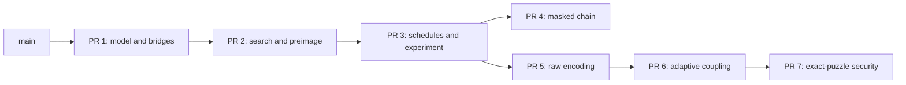

# Parallel QROM: review and integration stack

The branch contains four themes: the parallel model and bridges, search and preimage bounds,
the masked-chain puzzle, and the exact pointer-chain puzzle. Seven PRs keep those themes while
separating reusable execution machinery and the three distinct pointer-chain proof obligations.
No additional mathematical track needs to start before this stack is prepared and reviewed.

## Audited snapshot and integration base

This inventory is pinned to feature tip `c825f7e72ecb2a80cffa7913276067f8c3722ba4` and its
fork point `4482d49ab0c9da80905cf77d5d9b9ac163576481`. It covers 24 feature commits, 93 changed
files, and 16,806 added / 25 deleted lines. Of those, 60 production Lean files contribute
11,661 added / 3 deleted lines and 22 tests contribute 3,906 added lines. The remaining changes
are generated umbrellas (79 added lines) and documentation (1,160 added / 22 deleted lines).
These are tree-diff counts, not sums of commit churn.

The locally recorded `origin/main` is `a78095f91934ed6d3dcbca220e6f37da7736b0d0`, 38 commits
beyond the fork. In particular, PR #1169 ports main to Lean 4.36 and updated PolyFun measure
and program-logic APIs. The feature snapshot was validated on its own Lean 4.35 dependency
set. Its existing build results do not certify a replay onto current main.

Use the merge-base feature diff, for example
`git diff origin/main...6dd13debe`, to inspect the consolidated code. A two-dot diff against current main
also includes reversals of unrelated main-branch changes. The branch has not been rebased,
split, pushed or submitted as PRs by this planning step.

The root-accumulated masked-chain improvement is committed as
`6dd13debeff8f7eb8fb3953ea5e5a58ee2c6a65b`. Its bounds, scheme wrappers and regressions belong
in PR 4. Relative to the audited tip, that commit changes seven files by 593 added / 2 deleted
lines. Measured from the fork, PR 4 now contributes 3,047 added lines and no deletions; the
other application counts are unchanged. The table below includes this consolidation.

At that code tip, the whole feature has 25 commits and 95 changed files with 17,397 added /
25 deleted lines: 61 production Lean files (12,087 added / 3 deleted), 23 tests (4,069 added),
three generated umbrellas (81 added), and the eight existing documentation files (1,160 added /
22 deleted). The companion documentation update, including this plan and the concrete parameter
table for PR 7, is outside that code-tip inventory. Any later shared numerical inequalities
belong in PR 2 and execution helpers in PR 3.

## Lean 4.36 integration

The integration uses reviewed feature commit `54b6ae83ab4819727e71be7188e0ef4658197bd9` and
main commit `f1e63c780de398fb62206dd5890f27e1ad64e0e6`, with main's unchanged dependency pins
and validation baselines. The original feature branch is preserved. The
[port validation record](parallel-qrom-port-validation.json) contains source and tool hashes,
the exact theorem list, commands, API exceptions and whole-library check results.

All 28 priority headline types are identical as raw kernel expressions, including their
universe parameters, instance binders and hypotheses. Captured semantic definition bodies and
reducibility settings are unchanged. The new kernel accepts all 37 original headline/helper
propositions at their current constants.

Eight public helper lemmas and one private averaging lemma take chosen measurable spaces as
explicit data on Lean 4.36. Its concrete-instance linter rejects their former closed-carrier
instance binders. Each chosen space is reinstated exactly; arbitrary-space quantification and
dependent singleton assumptions remain intact. Callers now pass these spaces explicitly, as in
`evalDist_quantumWindowScheme_solve hB H m outputSpace puzzle`. These are documented API
adaptations, not changes to the final security statements.

The raw audit deliberately reports these nine type differences. Its 293-to-292 imported-record
count also records lazy generation of the solver equation: ordinary frontend lookup of
`MaskedChainPuzzle.solveFrom.eq_def` succeeds, and a separate kernel check proves its original
type. No production compatibility lemma is added to reproduce a compiler artifact.

The audit scripts, this integration plan and the validation record stay on the integration
reference. Extracted PRs retain their own tests and documentation. Each cut must build and be
reviewed on its actual parent, then match the frozen Lean 4.36 contracts for its available
modules; the old-toolchain exceptions are not allowances for changes during splitting.

## Recommended stack

The shared stack is main → PR 1 → PR 2 → PR 3. The masked-chain application branches from
PR 3 as PR 4; the exact-puzzle application follows PR 3 → PR 5 → PR 6 → PR 7. Each PR targets
the branch in the table until that parent merges. The counts below exclude shared
documentation and umbrella changes.



| PR | Review unit | Production Lean +tests, added / deleted lines | Target branch | Mathematical prerequisites |
|---|---|---:|---|---|
| 1 | Variable-width parallel model, sequentialization and classical/compressed bridges | 3,150 / 2 | main | Existing sequential quantum layer |
| 2 | Parallel reprogramming, marked search and fixed-target preimage search | 2,523 / 0 | PR 1 | PR 1 |
| 3 | Numbered schedules, retained-state finishers and quantum time-lock game | 2,870 / 0 | PR 2 | PR 2, including PR 1 |
| 4 | Idealized masked-chain coupling and endpoint security with preprocessing | 3,047 / 0 | PR 3 | Shared stack through PR 3 |
| 5 | Complete raw-table encodings and finite byte windows | 946 / 1 | PR 3 | PRs 1 and 3; PR 2 is inherited |
| 6 | Adaptive programming and exact pointer-chain coupling | 1,709 / 0 | PR 5 | PR 5 |
| 7 | Rank-cutoff quantum recovery and exact-puzzle preprocessing security | 1,911 / 0 | PR 6 | PR 6 and inherited PRs 2–3 |

PR 5 targets PR 3 directly and has no masked-chain dependency. PR 7 uses search and schedule
helpers from PRs 2–3, already inherited through PR 6's ancestors; those uses do not add target
branches or a dependency on PR 4. The exact-puzzle review path has six PR reviews and five
PR-to-PR edges, compared with seven reviews in the linear stack. PR 4 can be reviewed in
parallel with PRs 5–7. The total remains seven PRs; the shorter path does not by itself
guarantee a particular review time.

A file-level import audit of the committed production/test files is consistent with this
tree and finds no dependency between its two application branches. It does not establish
that reconstructed intermediate trees build: their selected existing-file hunks,
documentation and regenerated exports still need validation.
The four thematic PRs alone would leave roughly 4–6k-line application reviews and mix the raw
encoding, adaptive coupling and quantum rank argument in one pointer-chain review.

## File allocation and acceptance targets

The paths in each code block are relative to the named directory. Keep the corresponding
test modules and documentation with the layer that first makes their claims true.

### PR 1: model and bridges

Under `VCVio/Quantum/`:

```text
Foundations/Parallel.lean
Comp/Parallel.lean
Comp/RoundBound.lean
Comp/Sequentialize.lean
Oracle/Parallel.lean
Oracle/Sequentialize.lean
Oracle/ClassicalParallel.lean
Oracle/ClassicalRandomized.lean
Oracle/Compressed/Parallel.lean
Oracle/Classical.lean                  # existing-file additions and stale-scope correction
```

Tests under `VCVioTest/Quantum/`: Parallel, Sequentialize, ParallelBridges and
ClassicalRandomized. Lean module names are obtained by prefixing these names with
`VCVioTest.Quantum.`.

The review contract is ordered batching separated from the simultaneous additive-oracle law,
one sampled function for every round, full-run sequentialization at the point budget, and
classical/private-coin and compressed-runtime transport. Duplicate inputs, zero width,
entangled slots and branch-dependent widths belong in this PR's regressions. Do not attach
a depth-sensitive security claim to sequentialization alone. The batching API restricts ports
to matching input/output registers and a unit classical result; it does not batch arbitrary
classical-read result ports.

Provenance: `8310cc9fa`, `546a46668`, `1921c5d0f`, `413fe75d9`, `d2dbe3b77`.

### PR 2: search and preimage

Under `VCVio/Quantum/`:

```text
Foundations/Hybrid.lean
Comp/ChargeWeight.lean
Comp/HybridBudget.lean
Comp/Runtime.lean                     # observed-run subprobability instance
Oracle/ParallelReprogramming.lean
Oracle/ParallelHybrid.lean
Oracle/ParallelFinding.lean
Oracle/ParallelSearch.lean
Oracle/ParallelPreimage.lean
```

Also include `ToMathlib/MeasureTheory/Measure/UniformTable/Bounds.lean` and
`ToMathlib/MeasureTheory/Measure/UniformTable/Target.lean`. The latter imports the former;
the generic table bounds cannot wait for the masked-chain PR.

Tests: ChargeWeight, ParallelSearch and ParallelPreimage. The acceptance statements retain
zero-query guessing and failure mass, quantify over the correct hidden-mark/fixed-target
games, and cover both rounds/width and rounds/total-points search bounds. The sampled-set
comparison must state that its reference query state is independent of the sampled set.

The observed-run subprobability instance in Runtime is needed by the final search proofs'
measure bounds, although it first appeared during numbered-query work. Import edges alone do
not expose this inherited-instance dependency.

Provenance: `3a2f4d7ac`, `b97f861d7`, `023b141b0`, `adb7e50ab`, plus the table-bound file
introduced in `1e1093330` and shared root-aggregation additions from `d6b442754`, `0aefbaca6`
and `f762edb5d`.

### PR 3: schedules and two-phase experiment

Under `VCVio/Quantum/`:

```text
Comp/NumberedQueries.lean
Comp/NumberedHybrid.lean
Comp/DropEmptyBatches.lean
Comp/Finisher.lean
Comp/Homogeneous.lean
Foundations/Observation.lean
Foundations/PrivateUnit.lean
Foundations/SubState.lean
Oracle/LocalExecution.lean
Oracle/ParallelSchedule.lean
Oracle/ParallelFinisher.lean
```

Also include `VCVio/CryptoFoundations/TimeLockPuzzle/Quantum.lean` and
`VCVio/CryptoFoundations/TimeLockPuzzle/QuantumClassical.lean`. Tests: NumberedQueries,
DropEmptyBatches, SubState and TimeLockPuzzle.

Review generic execution laws independently of a puzzle: rectangular scheduled oracles,
prefix query-state equality, complete continuations as common observed finishers, trace
scaling, and empty-batch removal. The experiment must retain the actual preprocessing
register, share one oracle across all phases, and keep the hidden challenger data joint
with the final observation. Preprocessing budgets count queries while retained memory is
unrestricted; they do not specify bounded advice from unbounded preprocessing. The security
predicate is a target proved by later PRs.

Provenance: `d6b442754`, `b9aa3bc79`, `190b9f1f2`, generic parts of `0aefbaca6` and
`f762edb5d`, and generic experiment-law additions from `d19c76d7b` and `de4683db2`.

### PR 4: masked-chain application

Include all committed files under `VCVio/Quantum/Oracle/MaskedChain/`,
`VCVio/Schemes/MaskedChainPuzzle.lean`, and
`VCVio/Schemes/MaskedChainPuzzle/Preprocessing.lean`. Tests: MaskedChain and
QueryBoundedPreprocessing and MaskedChainRootBounds. The independently reviewed consolidation
adds the root-bound module and its actual-game regressions to this layer.

The review should first establish the mask-first coupling and joint endpoint event, then
the actual conditional online bound, then query-bounded preprocessing and the named scheme
theorems. Check repeated vertices, the one-round endpoint gap, mass scaling across retained
branches, and that the classical collision loss occurs once outside any squared root error.
Keep paper statements distinct from bounds derived by the formalization.

Provenance: `1e1093330`, `357816c18`, `d19c76d7b`, masked-chain parts of `0aefbaca6`,
`023b141b0` and `f762edb5d`, plus `6dd13debe`.

### PR 5: complete raw encoding

```text
ToMathlib/Data/ByteArray/Bounded.lean
ToMathlib/MeasureTheory/Measure/UniformTable/Encoding.lean
VCVio/Quantum/Oracle/Encoding.lean
VCVio/Schemes/PointerChainPuzzle/Basic.lean          # finite Point enumeration for encoding
VCVio/Schemes/PointerChainPuzzle/QuantumEncoding.lean
```

Tests: OracleEncoding and PointerChainEncoding. Require exact honest gen/solve agreement,
the full raw response including truncated-mask tails, and all bounded raw inputs including
malformed and outside-image cells. The adversary retains its raw query signature. Establish
the finite-window honest-input bounds and domain-separation premises explicitly. This PR
contains encoding/equality results, without a quantum delay claim.

Provenance: `de4683db2` and `b24d3bcfe`. Their generic experiment-law hunks belong in PR 3.

### PR 6: adaptive coupling

```text
ToMathlib/MeasureTheory/Measure/UniformTable/Adaptive.lean
VCVio/Schemes/PointerChainPuzzle/RankFrontier.lean
VCVio/Schemes/PointerChainPuzzle/QuantumCoupling/Programming.lean
VCVio/Schemes/PointerChainPuzzle/QuantumCoupling.lean
VCVio/Schemes/PointerChainPuzzle/QuantumCoupling/Scheme.lean
```

Tests: AdaptiveProgramming, PointerChainFrontier, PointerChainProgramming and
PointerChainCoupling. Review adaptive label exchanges and reverse-order programming before
the honest-generator comparison. Preserve full raw tails and current cell tails on repeated
addresses. The actual quantum game hop retains preprocessing and charges only path-input
collisions; it samples path responses unconditionally and assumes no query budget.

Provenance: `78802d17a`, `60868dde7`, `1495f97b4`, and the 37-line generic adaptive-programming
addition in `f762edb5d`.

### PR 7: exact-puzzle rank security

Under `VCVio/Schemes/PointerChainPuzzle/QuantumCoupling/`:

```text
RankSchedule.lean
Incidence.lean
RankHybrid.lean
RankBounds.lean
PreprocessingIncidence.lean
Preprocessing.lean
```

Tests: PointerChainRankSchedule, PointerChainRankBounds and PointerChainPreprocessing.
Review the rank-limited reference state, full raw-word resampling, commitment cell timing,
and final joint key guess before composing preprocessing. Later accumulator inputs have no
salt field; their two independent state coordinates supply the stronger preprocessing
incidence. The actual experiment must use the programmed oracle for both phases; replacing
only preprocessing by the base oracle is an explicit charged hybrid.

The security contract is a bound on every syntactically round-bounded online branch with
query-bounded preprocessing and unrestricted retained memory. Keep the window-length
parameter out of the numerical error, but retain the finite-window and structured-puzzle
interface premises. The key's receipt round and the checked solver's extra commitment call
are different clocks. Include the concrete parameter table with all resource assumptions.

Provenance: `a29a5aa2c`, `c825f7e72`, and the consolidation's numerical documentation.

## Assembly and validation procedure

1. Preserve the audited feature tip and record its tree/dependency pins before constructing
   an integration stack. Leave the reviewed development history and the user's other
   checkout intact.
2. Choose and record a current main commit, then create one isolated integration worktree
   for the complete feature. Port the whole feature once to that main's
   Lean/Mathlib/PolyFun/QuantumFoundations versions, including its statistical-distance naming
   and measure API changes. Run the full build, regressions, kernel sweep, lint, initializer
   and source-boundary checks before freezing the validated ported tree and its dependency
   pins as the reference for all seven cuts. Do not port seven independent copies.
3. Incorporate integration and review feedback into that ported reference, then rerun the
   affected checks before extracting further cuts. Assemble PRs 1–3 from this single
   reference, then construct PR 4 and the PR 5–7 branch on their explicit bases above.
   Provenance is not a blind cherry-pick recipe:
   `023b141b0` also edits a masked-chain file that does not yet exist at PR 2;
   `f762edb5d` spans PRs 2, 3, 4 and 6; shared game files evolve in several later commits.
   Use final module ownership and selected existing-file hunks, preserving public names and
   required attribution.
4. Regenerate all umbrellas after each layer. Keep only modules present in that layer, and
   split tutorial/status/citation edits alongside their proofs. Defer the final
   QuantumEncoding/Scheme docstrings that cite the preprocessing security module until PR 7.
   Earlier PRs must not describe absent later theorems as established results.
5. Build each intermediate tree and its named tests on its actual target base; require
   independent mathematical and adversarial review of that PR's actual head. Validate both
   application branches separately, including the PR 5 branch without PR 4. Record commits,
   commands and results at each head. Passing checks on the complete ported reference do not
   certify each extracted tree.
6. PRs 1 and 2 are ready to submit for review once their ported heads independently build and
   pass local adversarial review. They can be reviewed before the application PRs are ready.
   Keep later fixes in the ported reference and propagate them to affected extracted heads,
   preserving the correspondence between that reference and the reviewed cuts.
7. Before enqueuing, inspect every check on the current PR head and follow the repository's
   merge-queue procedure. When PR 3 merges, retarget both PR 4 and PR 5 to main and revalidate
   both branches; PRs 6 and 7 continue to target their own immediate parents until those merge.
   Refresh and validate affected descendants after each parent merge or main-version change.
   Prepare PR text around each final diff and its exact scope.

For each layer, run the ordinary proof-library build, the named regression targets, and Smoke.
Run the axiom sweep at zero debt, environment/style lint against unchanged baselines,
initializer checks and the Extern/Interop/PolyFun/exposure guards on the assembled tree.
Run the generated-import and documentation checks after exports and prose are final.
Use the current main's CONTRIBUTING and validation scripts; do not copy old suppression or
dependency baselines into the integration stack.

## Upstream staging and remaining work

The five local quantum foundation modules are upstream candidates: Parallel (PR 1), Hybrid
(PR 2), and Observation, PrivateUnit and SubState (PR 3). Their external dependencies are
QuantumFoundations and Mathlib; PrivateUnit also imports the local Observation module.
Keep them staged locally for this stack and audit current
QuantumFoundations for equivalent APIs during the main-version port. Upstream complete,
generic groups separately afterwards, with their tests and stable public laws; dependency
bumps should not gate every application PR. The uniform-table and bounded-byte utilities
belong to the separate Mathlib-facing route.

The application bounds use online rounds and maximum width. A total-online-points refinement
is an optional follow-up and does not gate this stack; search already has its rounds/points
bound.

The security-bit predicate and secret-input preimage game form a follow-up to PR 2. They
reuse the sampled-set finding theorem, with a classical planted-target coupling for the
secret-input game. They add no compressed-oracle dependency and do not change the seven-cut
inventory pinned above. Carry their reviewed changes through the same single ported reference
before assembling that follow-up. The local note `parallel-qrom-security.pdf` motivates the
calibration; its separate collision argument does not complete the CFHL track.

Early-success quantum truncation, serialized public puzzles, coherent transport between
windows, unrestricted-length oracle interfaces, auxiliary-input preprocessing and the CFHL
track are outside this stack. In particular, the changing-property prerequisite for CFHL
is independent of the direct rank-hybrid results.
